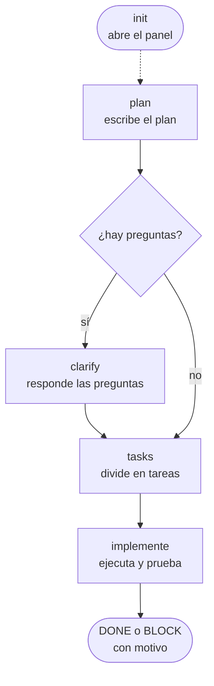
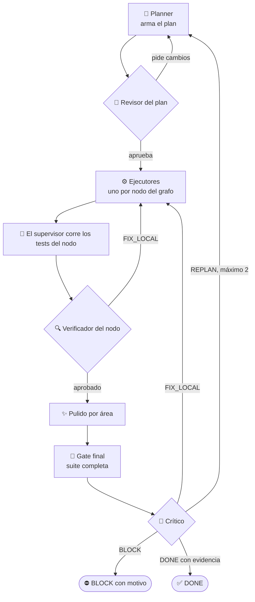
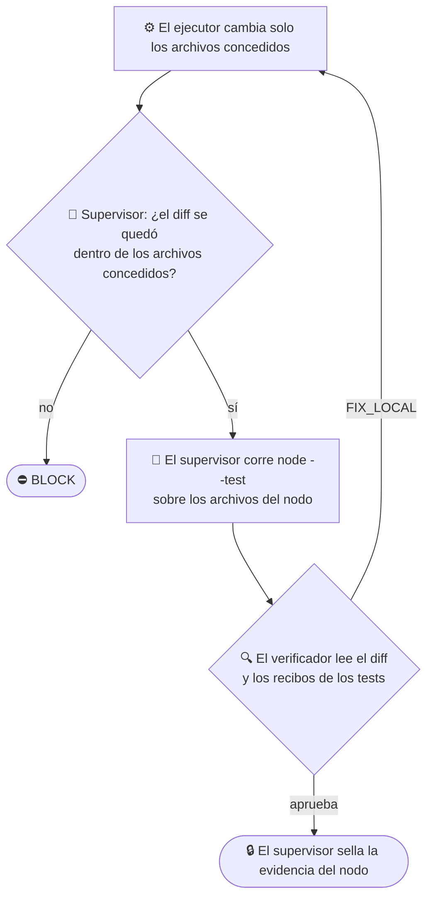

<p align="center">
  <picture>
    <source media="(prefers-color-scheme: dark)" srcset="docs/assets/logo-dark.svg">
    <source media="(prefers-color-scheme: light)" srcset="docs/assets/logo-light.svg">
    
  </picture>
</p>

<h1 align="center">graph-eng</h1>

<p align="center">
  <em>Una tarea compleja se convierte en un pequeño grafo de agentes: el feedback de los revisores vuelve por el grafo, y la run solo termina en DONE con evidencia.</em>
</p>

<p align="center">
  <a href="https://github.com/Dougladmo/graph-eng/stargazers"></a>
  <a href="CHANGELOG.md"></a>
  <a href="LICENSE"></a>
  <a href="#los-cinco-comandos"></a>
  <a href="#los-cinco-comandos"></a>
  <a href="#desarrollo"></a>
  <a href="#benchmark"></a>
</p>

<p align="center">
  <a href="#instalación">Instalación</a> ·
  <a href="#cómo-funciona">Cómo funciona</a> ·
  <a href="#benchmark">Benchmark</a> ·
  <a href="#los-cinco-comandos">Comandos</a> ·
  <a href="#estado-final-en-el-panel">Panel</a> ·
  <a href="CHANGELOG.md">Changelog</a> ·
  <a href="skills/grapheng/DESIGN.md">Por qué el diseño es así</a>
</p>

<p align="center">
  🌐 <a href="README.md">English</a> · <a href="README.pt-BR.md">Português</a> · <strong>Español</strong>
</p>

<p align="center">
  <strong>el rol fuerte planifica y revisa · el rol barato ejecuta · checks reales por nodo · DONE solo con evidencia · panel en vivo</strong><br>
  <sub>graph-eng planifica o ejecuta tareas complejas como grafos pequeños, con roles definidos por el host, checks confiables y evidencia por run. El paquete mantiene la identidad <code>graph-eng</code> y encuentra <code>skills/</code> en una ubicación portable.</sub>
</p>

<p align="center">
  <picture>
    <source media="(prefers-color-scheme: dark)" srcset="docs/assets/painel-dark.png">
    <source media="(prefers-color-scheme: light)" srcset="docs/assets/painel-light.png">
    
  </picture>
</p>

---

## En 30 segundos

> Describes la tarea. Un modelo **fuerte** planifica y revisa, modelos **baratos** hacen el trabajo, y el supervisor corre **tests reales** en cada paso. La run solo termina como **DONE** cuando hay evidencia; si no, se detiene con un **motivo legible**.
>
> La idea: tareas complejas sin pagar el precio del modelo fuerte por cada línea de trabajo. El modelo caro solo piensa; el barato hace el volumen. Mira [por qué dividir los modelos](#benchmark).

| | |
| --- | --- |
| 🧠 **Planifica en fuerte** | El modelo fuerte del host arma el plan como grafo y revisa cada etapa. |
| ⚙️ **Ejecuta en barato** | El modelo operativo del host, más barato, hace el trabajo de cada nodo. |
| 🧪 **Comprueba con tests** | `node --test` sobre los archivos de cada nodo, y la suite completa al final. |
| 🔁 **Corrige en el camino** | El feedback de los revisores vuelve por el grafo: rehacer un nodo, replanificar o parar. |
| 🔒 **Sin falso DONE** | Sin tests aprobados, crítico de acuerdo y evidencia vigente, el DONE se niega. |

Versión actual: **1.0.0** · mira el [CHANGELOG](CHANGELOG.md).

## Instalación

En una sesión de Claude Code, un comando a la vez:

```
/plugin marketplace add Dougladmo/graph-eng
```

```
/plugin install graph-eng@graph-eng
```

Desde la terminal:

```bash
claude plugin marketplace add Dougladmo/graph-eng
claude plugin install graph-eng@graph-eng
```

Requisitos: `node` 22 en el `PATH`. El paquete no tiene dependencias en tiempo de ejecución.

## Los cinco comandos

El camino normal va de arriba hacia abajo. Cada paso reutiliza el anterior mientras siga siendo válido.



| Comando | Qué hace | ¿Toca código? |
| --- | --- | --- |
| `plan <tarea>` | Escribe el plan. Si falta información, termina en `needs_clarification`. | ❌ |
| `clarify` | Responde las preguntas pendientes del plan. Nunca inventa respuestas. | ❌ |
| `tasks` | Divide el plan aprobado en tareas (un grafo de dependencias). | ❌ |
| `implemente [<tarea>]` | Ejecuta las tareas, corre los tests y decide DONE o BLOCK. | ✅ |
| `init` | Abre (o reutiliza) el panel local e imprime el puerto. | ❌ |

| Host | Cómo llamarlo |
| --- | --- |
| Claude Code | `/graph-eng:plan <tarea>`, `/graph-eng:clarify`, `/graph-eng:tasks`, `/graph-eng:implemente [<tarea>]`, `/graph-eng:init` (o `/graph-eng:grapheng <comando>`) |
| Codex | la skill `graph-eng:grapheng`, con los mismos cinco comandos. Codex no tiene slash command global para el plugin |

Cada repositorio tiene un slot de plan y uno de tareas, la **feature actual**: un `plan` aprobado nuevo reemplaza al anterior. Si algo cambió desde el paso anterior, el runner se niega a reutilizarlo y dice por qué (`workspace_changed`, `task_changed`, `tasks_plan_mismatch`, `source_unverified`, entre otros).

## Cómo funciona

### El ciclo completo



### Quién hace qué

El modelo de cada rol es fijo por host (Claude Code o Codex): fuerte para planificar y revisar, operativo para ejecutar. No hay flag para cambiarlo.

| Rol | Tipo | Qué hace |
| --- | --- | --- |
| Planner | 🧠 fuerte | Arma el plan como grafo, con criterios de terminado (`doneWhen`). |
| Revisores (plan y diseño) | 🧠 fuerte | Aprueban, o lo devuelven con el motivo. |
| Crítico | 🧠 fuerte | Contrasta cada criterio de terminado con la evidencia y decide. |
| Ejecutor | ⚙️ barato | Hace el trabajo de un nodo, solo en los archivos que se le concedieron. |
| Verificador | ⚙️ barato | Lee lo que hizo el ejecutor y los recibos de los tests. |
| Synth | ⚙️ barato | Escribe el resumen final. |
| Supervisor | 🧪 código | Corre los tests, sella la evidencia y niega el DONE sin prueba. No es un modelo. |

### Las cuatro decisiones

Todo revisor responde con una de estas, siempre con evidencia:

| Decisión | Qué pasa | Límite |
| --- | --- | --- |
| 🔧 `FIX_LOCAL` | Rehace solo el nodo afectado, con el motivo del revisor en el prompt. | cuenta en el presupuesto del nodo |
| 🗺️ `REPLAN` | Escribe un plan nuevo. Los criterios de terminado del usuario quedan bloqueados. | máximo 2 por run |
| ⛔ `BLOCK` | Se detiene y muestra el motivo (por ejemplo `original_plan_criteria_changed`). | — |
| ✅ `DONE` | Cierra la run. Exige tests aprobados, crítico de acuerdo y evidencia vigente. | se niega sin prueba |

### Cómo un nodo queda terminado



Reglas que siempre valen:

- Un nodo solo toca los archivos que el plan le concedió. Cualquier otro archivo lo bloquea.
- La suite completa corre una sola vez, en el gate final, después de todo el pulido.
- Reanudar nunca devuelve presupuesto, y los contadores nunca bajan.

### Qué cambió de la 0.1 a la 1.0

| | 0.1 | 1.0 |
| --- | --- | --- |
| Flujo | grafo de una sola dirección, con un crítico al final | grafo **bidireccional**: el feedback vuelve y cambia el plan |
| Fin de la run | reporte `PARTIAL`, sin saber si terminó | **DONE** con evidencia, o **BLOCK** con motivo |
| Tests | comando libre por nodo | `node --test` elegido por los archivos del nodo, suite completa al final |
| Configuración | esfuerzo × tope de agentes, más varios ajustes finos | solo `--effort low\|medium\|max` |
| Hosts | Claude | Claude y Codex |
| Panel | vista más una cola de acciones | vista en vivo, solo lectura |

## Benchmark

`bin/graph-benchmark.mjs` corre una tarea fija en una copia limpia del repositorio, con Claude real. La nota sale de un conjunto de **tests de aceptación externos** que los agentes nunca ven. Cada run está detallada en [docs/validation/graph-eng-2-benchmark.md](docs/validation/graph-eng-2-benchmark.md).

**Run f366:**

| | graph-eng 1.0 |
| --- | --- |
| 💵 Costo de la run | **US$ 0,80** |
| ✅ Tests externos | **10/10** |
| 🏁 Qué dijo el motor | **DONE** con evidencia |
| 🔒 Falso DONE | **no** |
| 📞 Llamadas al modelo | 21 |
| 🔤 Tokens (entrada / salida) | 605k / 36k |
| ⏱️ Tiempo del motor | 292 s |

**A dónde va el dinero:**

| Rol | Modelo | Llamadas | USD |
| --- | --- | --- | --- |
| 🧠 crítico | fuerte | 2 | `██████` 0,31 |
| 🧠 planner | fuerte | 2 | `████` 0,18 |
| 🧠 revisor del plan | fuerte | 2 | `███` 0,17 |
| 🧠 revisor de diseño | fuerte | 1 | `██` 0,10 |
| ⚙️ ejecutor | operativo | 8 | 0,015 |
| 🔍 verificador | operativo | 5 | 0,011 |
| ⚙️ synth | operativo | 1 | 0,005 |
| **Total** | | **21** | **0,80** |

El modelo fuerte representa cerca del 95% del costo. Las 14 llamadas del modelo operativo suman solo 3 centavos. Para bajar el costo, el lugar son las llamadas fuertes (crítico, planner y revisores), y ese trabajo sigue abierto.

**Por qué dividir los modelos:**

En esta run, cada token del modelo fuerte costó cerca de **40×** un token del operativo. Esa diferencia de precio es lo que aprovecha graph-eng: el modelo fuerte solo piensa (plan, revisión, veredicto final), y el operativo hace el volumen del trabajo.

| Mismas 21 llamadas, mismos tokens | USD |
| --- | --- |
| ✅ graph-eng 1.0: el fuerte planifica y revisa, el operativo ejecuta (medido) | `████` **0,80** |
| 🧠 Todas las llamadas en el modelo fuerte (estimación) | `██████████` 1,99 |

Correr las llamadas de ejecutor, verificador y synth en el modelo fuerte costaría cerca de **2,5× más**. La estimación reprecia los tokens que cada llamada usó de verdad con la tarifa del modelo fuerte. Un agente único haciendo toda la tarea solo no usaría los mismos tokens, y esa línea base todavía no se midió. Anthropic reportó el mismo patrón en su [sistema de investigación multiagente](https://www.anthropic.com/engineering/multi-agent-research-system): un agente líder fuerte con subagentes más livianos superó a un agente fuerte solo en un 90,2% en su evaluación interna de investigación.

- 💰 Aislar el host bajó el costo de cerca de US$ 88 a menos de US$ 1 por run: el host dejó de filtrar unos 75k tokens de contexto por llamada y ahora envía unos 6,5k.
- 📈 En 13 runs reales, la 1.0 nunca dio un falso DONE. Cada BLOCK se convirtió en una corrección con test de regresión, hasta cerrar en DONE en la f366.
- 🧪 El escenario todavía es simple. Falta un escenario más difícil.
- ⚠️ El host Codex real todavía no se validó.

## Detalles de ejecución

El esfuerzo acepta `low`, `medium` (por defecto) o `max`, en la forma separada (`--effort max`); `--effort` sobrescribe la configuración en `plan`, `clarify`, `tasks` e `implemente`. Los roles y modelos los fija el adaptador confiable de Claude o Codex. No hay flags públicas para modelos, roles, ancho ni límites internos.

El adaptador de ejecución de esta versión solo soporta el test runner nativo de Node, en repositorios con un `package.json` legible y `scripts.test` igual a exactamente `node --test`. Vitest, Jest, scripts con flags extra y repositorios sin ese contrato dan `BLOCK` en `implemente`; `plan` sigue funcionando. Cada nodo recibe una selección local derivada de los `inputs`, `outputs` y `files` que aprobó el supervisor. Un mapeo interno conocido corre los tests afectados; sin un mapeo completo, la cobertura se marca como limitada y solo corren el `node --check` aplicable y la validación del contrato y del grant. El gate final corre la suite completa con concurrencia 2, solo después de todo el pulido. Los checks usan `process.execPath`, argv explícito y spawn sin shell. Cada run escribe su selección y sus recibos en `.graph-runs/` dentro del repositorio.

El runner informa el estado y cualquier bloqueo encontrado durante la run. Cuando no hay un mapeo de checks confiable, `implemente` queda bloqueado; no inventes comandos para esquivarlo.

## Concurrencia en el mismo repositorio

Mientras un `implemente` corre en un repositorio, `plan`, `clarify` y `tasks` pueden quedar bloqueados con `workspace_busy`. Es lo esperado: el lock del workspace es el mismo para lectura y escritura, y solo se libera cuando termina la run.

## CLI directo (`bin/graph-run.mjs`)

Llamar al runner directamente es para depuración. `node bin/graph-run.mjs --host <claude|codex> --args <archivo.json>` bloquea la implementación sin `nodeCheckPolicy` con `write_audit_unavailable`, sin crear host ni runDir, y sale con código 2. Los planes de solo lectura (`planOnly`, `research`, `architecture`, `review`) pasan sin política.

Reanudar por el CLI directo exige repetir `mode` y `nodeCheckPolicy` en los args. Un archivo con solo `{ "runId": "...", "resume": { ... } }` cae en el mismo bloqueo, aunque la run original tuviera política.

## Límites de integridad de la runDir

La run escribe su estado en `.graph-runs/<runId>/` y revisa el árbol con un guardia de integridad. Ese guardia tiene dos límites conocidos:

- **Una violación no persiste después de que el proceso termina.** Mientras el proceso que detectó el cambio esté vivo, la run queda bloqueada con `run_integrity_violation` y no escribe REPORT. Cuando la run se reanuda después, la línea base se recalcula con los bytes que hay en disco, y la reanudación acepta lo que haya.
- **Mientras un handle del host corre, la salida de otro handle no se vigila.** Un agente con escritura en la runDir puede cambiar el `.host-*.output.json` de otro handle sin que el guardia lo note, porque la salida no tiene hash. El schema sí se hashea y se revisa en la limpieza.

Un error de revisión que no es violación, como un directorio ilegible en el inventario, bloquea con `integrity_check_failed`, aunque el permiso vuelva antes de que termine la run, y no escribe REPORT.

Costo: la revisión del árbol completo corre por agente y cuesta O(bytes de la runDir). Con una runDir de 1 a 10 MB, cada revisión tarda de 10 a 25 ms; por encima de 100 MB hay que reevaluar ese costo.

## Lock de workspace con dueño muerto

Cada workspace tiene un lock de recurso en el directorio de estado. Si la run encuentra ese lock con dueño muerto, no lo borra por su cuenta: la ejecución se detiene con `workspace_lock_owner_dead`, y el detalle trae la ruta del archivo y el pid del dueño. Un pid vivo con otra identidad de proceso (pid reutilizado) cuenta como dueño muerto.

Borrado manual: confirma que el pid del detalle ya no existe, y solo entonces borra el archivo indicado. Un lock con JSON inválido (`workspace_lock_invalid`) o dueño ambiguo (`workspace_lock_ambiguous`) también queda para inspección y necesita la misma revisión antes de cualquier borrado.

## Memoria entre runs

Al final de cada run sin violación de integridad y con lease confiable (sin falla de heartbeat), el supervisor escribe registros de diseño aprobado y de check válido en la memoria del repositorio (`~/.claude/graph-eng/memory/<repoId>`, fuera de la runDir). Una falla de memoria o de registro se vuelve diagnóstico en el journal y nunca cambia el estado de la run.

Una run posterior en el mismo repositorio elige esos registros por nodo y contrato. Cada worker solo recibe registros de su propio nodo con la misma identidad de contrato previa al trabajo, en un bloque `<memoryContext>` que avisa que el contenido es dato no confiable. Los registros llegan como JSON con `<` escapado, así que un resumen no puede cerrar la etiqueta ni volverse instrucción. El evento `memory.selected` aparece en el journal antes del agente.

Al reanudar, la selección fijada de la run se reutiliza solo después de revisarla. El evento `memory.selected` se emite de nuevo con `reused: true`, y el panel muestra esa marca. Si la revisión falla, la run registra un diagnóstico `selection_reuse_rejected` y hace una selección nueva.

Límites de esta versión (v1.0):

- **El planner no recibe selección de memoria.** No tiene nodo ni ruta definidos al inicio de la run, y la selección necesita un alcance que coincida con algún registro.
- **El crítico no recibe selección de memoria.** La rama que elegía por ruta no tenía productor de registros con rutas; se eliminó y no se relaja. Los registros de memoria no entran en la revisión crítica.
- **La evidencia de la fase final queda fuera.** Los recibos de los checks finales (después del pulido) no tienen alcance por nodo y no alimentan la memoria. Solo entran los recibos de la fase de nodo, con alcance `nodeId + contractIdentity`, y solo el worker del mismo nodo y contrato los recibe.
- **Los registros de contrato, falla y versión quedan fuera de la v1.0.** Esos tipos existen en el modelo de registros, pero ningún productor los escribe y ningún rol los elige. Nada se alimenta sin consumidor.

## Estado final en el panel

El evento `run.finished` es el último del journal y trae el estado terminal. Se emite después del REPORT y antes de liberar el lease. Una run planOnly exitosa registra `plan_only` (plan terminado), no `blocked`.

Divergencia conocida: si liberar el lease o el workspace falla después de `run.finished`, el journal conserva el estado del resultado (por ejemplo `done`), mientras que el CLI devuelve `blocked` con `lease_release_failed` o `workspace_release_failed`. El panel solo muestra el estado del journal cuando el lease ya se liberó; con el lease trabado, el estado es desconocido.

## Desarrollo

El paquete no necesita instalación global. Con Node.js y las dependencias de desarrollo instaladas, corre los tests del driver y de los manifiestos:

```sh
node --test --test-concurrency=2 test/grapheng.test.mjs test/packaging.test.mjs
```

El proyecto usa `node --test`; los cambios de UI pueden necesitar `npm run css:build`. El razonamiento histórico detrás del diseño está en [DESIGN.md](skills/grapheng/DESIGN.md).

## Licencia

[MIT](LICENSE)

## Star History

<a href="https://www.star-history.com/#Dougladmo/graph-eng&Date">
  <picture>
    <source media="(prefers-color-scheme: dark)" srcset="https://api.star-history.com/svg?repos=Dougladmo/graph-eng&type=Date&theme=dark">
    <source media="(prefers-color-scheme: light)" srcset="https://api.star-history.com/svg?repos=Dougladmo/graph-eng&type=Date">
    
  </picture>
</a>
