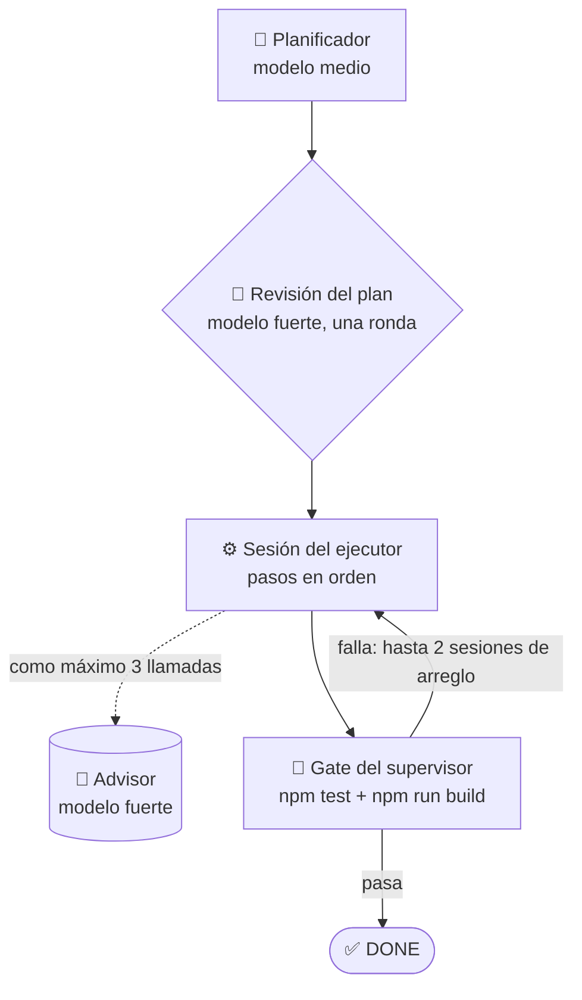

<p align="center">
  <picture>
    <source media="(prefers-color-scheme: dark)" srcset="docs/assets/logo-dark.svg">
    <source media="(prefers-color-scheme: light)" srcset="docs/assets/logo-light.svg">
    
  </picture>
</p>

<h1 align="center">graph-eng</h1>

<p align="center">
  <em>Un modelo medio planifica, el fuerte revisa y aconseja, uno barato hace los pasos simples, y la run solo termina DONE cuando pasan los tests y el build.</em>
</p>

<p align="center">
  <a href="https://github.com/Dougladmo/graph-eng/stargazers"></a>
  <a href="CHANGELOG.md"></a>
  <a href="LICENSE"></a>
  <a href="#comandos"></a>
  <a href="#comandos"></a>
  <a href="#desarrollo"></a>
  <a href="#benchmark"></a>
</p>

<p align="center">
  <a href="#primeros-pasos">Primeros pasos</a> ·
  <a href="#cómo-funciona">Cómo funciona</a> ·
  <a href="#comandos">Comandos</a> ·
  <a href="#flags">Flags</a> ·
  <a href="#benchmark">Benchmark</a> ·
  <a href="CHANGELOG.md">Changelog</a>
</p>

<p align="center">
  🌐 <a href="README.md">English</a> · <a href="README.pt-BR.md">Português</a> · <strong>Español</strong>
</p>

---

## En 30 segundos

> Describes la tarea. Un modelo **medio** escribe el plan, el modelo **fuerte** lo revisa una vez y queda de guardia como **advisor**, y el trabajo corre en **una sesión continua**: el modelo **barato** toma los pasos simples y repetitivos y el medio toma el resto. Al final, el supervisor corre `npm test` y `npm run build` él mismo. La run solo queda **DONE** si los dos pasan; si no, se detiene con un **motivo legible**.

| | |
| --- | --- |
| 🧠 **El fuerte solo revisa y aconseja** | Una revisión del plan y como máximo 3 llamadas al advisor por run. |
| 📝 **El medio planifica y hace los pasos difíciles** | Escribe el plan, marca la complejidad de cada paso y ejecuta los pasos `medium` y `high`. |
| ⚙️ **El barato hace los pasos simples** | Los pasos marcados `low` van al modelo barato por defecto. |
| 🧪 **Gate real** | `npm test` y `npm run build`, corridos por el supervisor, deciden el DONE. |
| 💰 **Más barato y más rápido** | La misma nota que un agente único en el modelo fuerte por cerca de un cuarto del costo, en menos de la mitad del tiempo ([benchmark](#benchmark)). |

Versión actual: **1.3.0** · ver el [CHANGELOG](CHANGELOG.md).

## Instalación

En una sesión de Claude Code, un comando a la vez:

```
/plugin marketplace add Dougladmo/graph-eng
```

```
/plugin install graph-eng@graph-eng
```

Desde la terminal:

```bash
claude plugin marketplace add Dougladmo/graph-eng
claude plugin install graph-eng@graph-eng
```

Requisitos: `node` 22 en el `PATH` y un repositorio con script `test` en `package.json` (el gate lo corre). El paquete no tiene dependencias de runtime.

## Primeros pasos

Pega esto en Claude Code, dentro de tu repositorio, y cambia la tarea (el prompt está en inglés para que funcione en cualquier proyecto):

```
Use graph-eng 1.3 (advisor flow) for this task. First run /graph-eng:plan with it and show me the plan; after I approve, run /graph-eng:implemente with no arguments.

Task: <describe what you want built or changed>
```

O sáltate la revisión y córrelo todo de una vez:

```
/graph-eng:implemente <tu tarea>
```

## Cómo funciona



1. **Plan.** El planificador (modelo medio, solo lectura) lee el repositorio y escribe los pasos, cada uno marcado `low`, `medium` o `high`, y qué significa "listo".
2. **Revisión.** El modelo fuerte revisa el plan una vez. Si pide cambios, sus notas van directo al ejecutor; no hay segunda ronda.
3. **Ejecución.** El ejecutor trabaja en una sesión continua, así que mantiene el contexto de un paso al siguiente. Cuando se traba, puede pedir consejo al modelo fuerte, como máximo 3 veces por run. Su shell solo corre `npm test` y `npm run build`.
4. **Gate.** El supervisor corre `npm test` y `npm run build` él mismo. Si alguno falla, el ejecutor recibe la salida del fallo en una sesión nueva, hasta 2 sesiones de arreglo, siempre en el modelo medio.

**Quién hace qué por defecto (host Claude):**

| Rol | Modelo | Por qué |
| --- | --- | --- |
| Revisión del plan y advisor | 🧠 fuerte | Criterio donde importa, pocas llamadas |
| Planificador | 📝 medio | Lee el código y escribe los pasos |
| Pasos `medium` y `high`, arreglos del gate | 📝 medio | El trabajo de verdad |
| Pasos `low` | ⚙️ barato | Trabajo simple y repetitivo |

Los pasos seguidos en el mismo modelo comparten una sesión. El presupuesto del advisor se comparte entre sesiones.

## Comandos

| Comando | Qué hace | ¿Toca el código? |
| --- | --- | --- |
| `plan <tarea>` | Escribe y revisa el plan, muestra la complejidad de cada paso y qué modelo lo toma, y lo guarda en `.graph-runs/advisor-plan.json`. | ❌ |
| `implemente <tarea>` | Hace todo en una run: plan, revisión, ejecución y gate. | ✅ |
| `implemente` | Ejecuta el último plan guardado por `plan`, con el ruteo elegido ahí. | ✅ |

| Host | Cómo llamarlo |
| --- | --- |
| Claude Code | `/graph-eng:plan <tarea>`, `/graph-eng:implemente [<tarea>]` (o `/graph-eng:grapheng <comando>`) |
| Codex | la skill `graph-eng:grapheng`, con los mismos dos comandos. Codex no tiene slash global para el plugin |

## Flags

Siempre en la forma separada (`--effort max`, nunca `--effort=max`).

| Flag | Valores | Por defecto | Qué hace |
| --- | --- | --- | --- |
| `--effort` | `low`, `medium`, `max` | `medium` | Esfuerzo de razonamiento de todas las llamadas de la run. |
| `--haiku-max` | `low`, `medium`, `off` | `low` en Claude | Complejidad máxima de paso que va al modelo barato. `off` deja todos los pasos en el medio. |
| `--executor` | `sonnet`, `haiku` | ninguno | Un modelo para todos los pasos. Apaga el ruteo y no se combina con `--haiku-max`. |

`--haiku-max` y `--executor` solo existen en el host Claude; en Codex el flujo no rutea. En `implemente` sin tarea, el ruteo viene del plan guardado, así que pasa esas dos flags en `plan`.

Ejemplos:

```
/graph-eng:implemente agregar modo oscuro a la página de ajustes --effort max
```

```
/graph-eng:plan migrar los helpers de fecha a Temporal --haiku-max medium
```

## Resultados y bloqueos

| Status | Significado |
| --- | --- |
| `planned` | `plan` terminó y el plan quedó guardado. |
| `done` | El gate pasó y el ejecutor declaró todos los pasos listos. |
| `blocked` | La run se detuvo. El motivo viene junto. |

Motivos de bloqueo: `advisor_gate_missing_test` (sin script `test` en `package.json`), `advisor_plan_missing` (`implemente` sin tarea y sin plan guardado), `advisor_plan_host_mismatch` (plan guardado de otro host), `advisor_gate_failed` (tests o build siguen fallando después de los arreglos), `advisor_executor_blocked` (el gate pasó, pero el ejecutor declaró un paso bloqueado), `advisor_call_failed` (falló una llamada al modelo).

Cada run deja su evidencia en `.graph-runs/<runId>/advisor-run.json`: plan, revisión, ruteo, sesiones, salida del gate, llamadas y costo por modelo y por rol.

## Benchmark

**Minecraft MVP (22 y 23/10/2026):** un clon jugable de Minecraft en React y three.js, desde un esqueleto vacío. La nota sale de **55 tests de aceptación ocultos** que los agentes nunca ven, más `npm run build` y un chequeo visual en el navegador (crear mundo, caminar, minar, poner un bloque, abrir el inventario). Una run por variante, Claude real.

| Variante | Tests ocultos | Costo | Tiempo |
| --- | --- | --- | --- |
| 🧠 Agente único en el modelo fuerte, sin graph-eng | 55/55 | US$ 5.97 | 23 min |
| Advisor, el modelo medio ejecuta todo (`--executor sonnet`) | 55/55 | US$ 1.79 | 11 min |
| Advisor, el modelo barato ejecuta todo (`--executor haiku`) | 54/55 | US$ 2.33 | 20 min |
| Advisor, modelo barato en `low` + `medium` (`--haiku-max medium`) | 55/55 | US$ 1.66 | 12.5 min |
| ✅ Advisor, modelo barato en `low` (por defecto) | **55/55** | **US$ 1.59** | **10 min** |

- 💰 El modo por defecto sacó la misma nota que el agente único en el modelo fuerte por **cerca de un cuarto del costo** (US$ 1.59 contra US$ 5.97), en **menos de la mitad del tiempo**. Todas las variantes del advisor mostraron el juego en pantalla sin errores en la consola.
- 🐢 El modelo barato solo en toda la tarea fue más lento y más caro: llamó al advisor una vez (US$ 1.21) y aun así falló un test de física. Por eso solo toma los pasos simples.
- ✂️ Dividido por paso, el modelo barato resolvió todo lo que recibió. Con `medium` tomó 4 de 10 pasos por US$ 0.06, sin errores.
- ⚠️ El ruteo solo ahorró entre 7% y 11% aquí, porque el planificador marcó 6 de 10 pasos como `high`. Con una run de cada una, 10% de diferencia está dentro de la variación normal.

**A dónde fue el dinero en la run por defecto (US$ 1.59):**

| Rol | Modelo | USD |
| --- | --- | --- |
| 📝 Planificador | medio | `█` 0.14 |
| 🧠 Revisión del plan | fuerte | `█` 0.15 |
| ⚙️ Sesiones del ejecutor (pasos `medium`/`high`) | medio | `████████` 1.29 |
| ⚙️ Sesiones del ejecutor (pasos `low`) | barato | 0.01 |
| 🧠 Advisor | fuerte | 0 (no se llamó) |

El modelo fuerte costó menos del 10% de la run. La evidencia cruda de cada run está en [docs/benchmarks/](docs/benchmarks/).

### Por qué se quitó el motor de grafo

Hasta la 1.2, graph-eng también tenía un flujo de grafo: la tarea se volvía un grafo de nodos, cada uno corrido por un agente barato separado, con verificadores, un critic y revisores en el medio. En tareas pequeñas funcionaba, pero en la tarea de Minecraft hizo 5 intentos, gastó US$ 7.58 y nunca entregó un juego funcionando. Cada nodo empezaba sin el contexto de los otros, y las capas de revisión costaban más que el propio trabajo. El flujo advisor mantiene la parte buena (el modelo fuerte solo piensa, los más baratos hacen el volumen, un gate real decide el DONE) en una sesión continua. En la 1.3.0 se quitaron el motor de grafo, los comandos `clarify`, `tasks` e `init`, `--adaptive`, `--flow` y el panel local.

## Desarrollo

El paquete no necesita instalación. Corre los tests con:

```sh
node --test --test-concurrency=2
```

## Licencia

[MIT](LICENSE)

## Star History

<a href="https://www.star-history.com/#Dougladmo/graph-eng&Date">
  <picture>
    <source media="(prefers-color-scheme: dark)" srcset="https://api.star-history.com/svg?repos=Dougladmo/graph-eng&type=Date&theme=dark">
    <source media="(prefers-color-scheme: light)" srcset="https://api.star-history.com/svg?repos=Dougladmo/graph-eng&type=Date">
    
  </picture>
</a>
