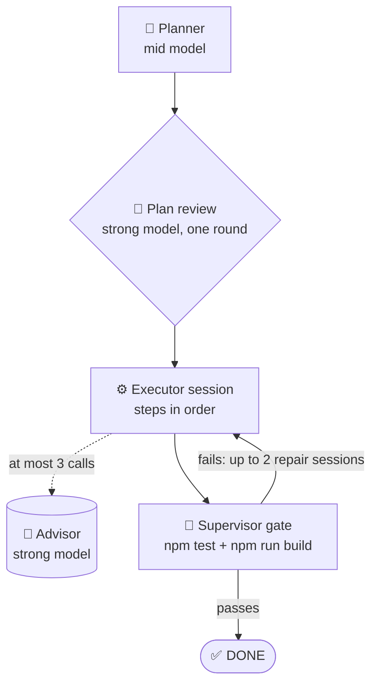

<p align="center">
  <picture>
    <source media="(prefers-color-scheme: dark)" srcset="docs/assets/logo-dark.svg">
    <source media="(prefers-color-scheme: light)" srcset="docs/assets/logo-light.svg">
    
  </picture>
</p>

<h1 align="center">graph-eng</h1>

<p align="center">
  <em>A mid model plans, the strong model reviews and advises, a cheap model does the simple steps, and the run only ends DONE when the tests and the build pass.</em>
</p>

<p align="center">
  <a href="https://github.com/Dougladmo/graph-eng/stargazers"></a>
  <a href="CHANGELOG.md"></a>
  <a href="LICENSE"></a>
  <a href="#commands"></a>
  <a href="#commands"></a>
  <a href="#development"></a>
  <a href="#benchmark"></a>
</p>

<p align="center">
  <a href="#first-steps">First steps</a> ·
  <a href="#how-it-works">How it works</a> ·
  <a href="#commands">Commands</a> ·
  <a href="#flags">Flags</a> ·
  <a href="#benchmark">Benchmark</a> ·
  <a href="CHANGELOG.md">Changelog</a>
</p>

<p align="center">
  🌐 <strong>English</strong> · <a href="README.pt-BR.md">Português</a> · <a href="README.es.md">Español</a>
</p>

---

## In 30 seconds

> You describe the task. A **mid** model writes the plan, the **strong** model reviews it once and stays on call as an **advisor**, and the work runs in **one continuous session**: the **cheap** model takes the simple, repetitive steps and the mid model takes the rest. At the end the supervisor runs `npm test` and `npm run build` itself. The run is **DONE** only if both pass; otherwise it stops with a **readable reason**.

| | |
| --- | --- |
| 🧠 **Strong model only reviews and advises** | One plan review, plus at most 3 advisor calls per run. |
| 📝 **Mid model plans and does the hard steps** | It writes the plan, marks each step's complexity and executes the `medium` and `high` steps. |
| ⚙️ **Cheap model does the simple steps** | Steps marked `low` go to the cheap model by default. |
| 🧪 **Real gate** | `npm test` and `npm run build`, run by the supervisor, decide DONE. |
| 💰 **Cheaper and faster** | Same grade as a single strong-model agent for about a quarter of the cost, in less than half the time ([benchmark](#benchmark)). |

Current version: **1.3.0** · see the [CHANGELOG](CHANGELOG.md).

## Installation

In a Claude Code session, one command at a time:

```
/plugin marketplace add Dougladmo/graph-eng
```

```
/plugin install graph-eng@graph-eng
```

From the terminal:

```bash
claude plugin marketplace add Dougladmo/graph-eng
claude plugin install graph-eng@graph-eng
```

Requirements: `node` 22 on the `PATH`, and a repository with a `test` script in `package.json` (the gate runs it). The package has no runtime dependencies.

## First steps

Paste this into Claude Code, inside your repository, and swap in your task:

```
Use graph-eng 1.3 (advisor flow) for this task. First run /graph-eng:plan with it and show me the plan; after I approve, run /graph-eng:implemente with no arguments.

Task: <describe what you want built or changed>
```

Or skip the review and run everything at once:

```
/graph-eng:implemente <your task>
```

## How it works



1. **Plan.** The planner (mid model, read-only) reads the repository and writes the steps, each marked `low`, `medium` or `high`, plus what "done" means.
2. **Review.** The strong model reviews the plan once. If it asks for changes, its notes go straight to the executor; there is no second round.
3. **Execute.** The executor works in one continuous session, so it keeps context from one step to the next. When it gets stuck it can ask the strong model for advice, at most 3 times per run. Its shell only runs `npm test` and `npm run build`.
4. **Gate.** The supervisor runs `npm test` and `npm run build` itself. If either fails, the executor gets the failure output in a new session, up to 2 repair sessions, always on the mid model.

**Who does what by default (Claude host):**

| Role | Model | Why |
| --- | --- | --- |
| Plan review and advisor | 🧠 strong | Judgment where it matters, a few calls only |
| Planner | 📝 mid | Reads the code and writes the steps |
| `medium` and `high` steps, gate repairs | 📝 mid | The real work |
| `low` steps | ⚙️ cheap | Simple, repetitive work |

Consecutive steps on the same model share one session. The advisor budget is shared across sessions.

## Commands

| Command | What it does | Touches code? |
| --- | --- | --- |
| `plan <task>` | Writes and reviews the plan, shows each step's complexity and which model takes it, and saves it in `.graph-runs/advisor-plan.json`. | ❌ |
| `implemente <task>` | Does everything in one run: plan, review, execution and gate. | ✅ |
| `implemente` | Runs the last plan saved by `plan`, with the routing chosen there. | ✅ |

| Host | How to call it |
| --- | --- |
| Claude Code | `/graph-eng:plan <task>`, `/graph-eng:implemente [<task>]` (or `/graph-eng:grapheng <command>`) |
| Codex | the `graph-eng:grapheng` skill, with the same two commands. Codex has no global slash command for the plugin |

## Flags

Always in the separated form (`--effort max`, never `--effort=max`).

| Flag | Values | Default | What it does |
| --- | --- | --- | --- |
| `--effort` | `low`, `medium`, `max` | `medium` | Reasoning effort for every call in the run. |
| `--haiku-max` | `low`, `medium`, `off` | `low` on Claude | Highest step complexity that goes to the cheap model. `off` keeps every step on the mid model. |
| `--executor` | `sonnet`, `haiku` | none | One model for every step. Turns routing off and does not combine with `--haiku-max`. |

`--haiku-max` and `--executor` only exist on the Claude host; on Codex the flow does not route. With `implemente` and no task, routing comes from the saved plan, so pass these two flags to `plan`.

Examples:

```
/graph-eng:implemente add dark mode to the settings page --effort max
```

```
/graph-eng:plan migrate the date helpers to Temporal --haiku-max medium
```

## Results and blocks

| Status | Meaning |
| --- | --- |
| `planned` | `plan` finished and the plan was saved. |
| `done` | The gate passed and the executor reported every step done. |
| `blocked` | The run stopped. The reason comes with it. |

Block reasons: `advisor_gate_missing_test` (no `test` script in `package.json`), `advisor_plan_missing` (`implemente` with no task and no saved plan), `advisor_plan_host_mismatch` (saved plan is from another host), `advisor_gate_failed` (tests or build still failing after the repairs), `advisor_executor_blocked` (gate passed but the executor reported a step blocked), `advisor_call_failed` (a model call failed).

Every run leaves its evidence in `.graph-runs/<runId>/advisor-run.json`: plan, review, routing, sessions, gate output, calls and cost split by model and role.

## Benchmark

**Minecraft MVP (2026-10-22 and 23):** a playable Minecraft clone in React and three.js, from an empty skeleton. The grade comes from **55 hidden acceptance tests** the agents never see, plus `npm run build` and a visual check in the browser (create a world, walk, mine, place a block, open the inventory). One run per variant, real Claude.

| Variant | Hidden tests | Cost | Time |
| --- | --- | --- | --- |
| 🧠 Single strong-model agent, no graph-eng | 55/55 | $5.97 | 23 min |
| Advisor, mid model executes everything (`--executor sonnet`) | 55/55 | $1.79 | 11 min |
| Advisor, cheap model executes everything (`--executor haiku`) | 54/55 | $2.33 | 20 min |
| Advisor, cheap model on `low` + `medium` (`--haiku-max medium`) | 55/55 | $1.66 | 12.5 min |
| ✅ Advisor, cheap model on `low` (default) | **55/55** | **$1.59** | **10 min** |

- 💰 The default got the same grade as the single strong-model agent for **about a quarter of the cost** ($1.59 vs $5.97), in **less than half the time**. Every advisor variant showed the game on screen with no console errors.
- 🐢 The cheap model alone on the whole task was slower and more expensive: it called the advisor once ($1.21) and still failed one physics test. That is why it only gets the simple steps.
- ✂️ Split by step, the cheap model handled everything it got. With `medium` it took 4 of 10 steps for $0.06, with no errors.
- ⚠️ Routing only saved 7% to 11% here, because the planner marked 6 of 10 steps as `high`. With one run each, a 10% difference is within normal variance.

**Where the money went in the default run ($1.59):**

| Role | Model | USD |
| --- | --- | --- |
| 📝 Planner | mid | `█` 0.14 |
| 🧠 Plan review | strong | `█` 0.15 |
| ⚙️ Executor sessions (`medium`/`high` steps) | mid | `████████` 1.29 |
| ⚙️ Executor sessions (`low` steps) | cheap | 0.01 |
| 🧠 Advisor | strong | 0 (not called) |

The strong model cost under 10% of the run. Raw evidence for every run is in [docs/benchmarks/](docs/benchmarks/).

### Why the graph engine was removed

Up to 1.2, graph-eng also had a graph flow: the task became a graph of nodes, each run by a separate cheap agent, with verifiers, a critic and reviewers between them. On small tasks it worked, but on the Minecraft task it took 5 attempts, spent $7.58 and never delivered a working game. Each node started without the context of the others, and the review layers cost more than the work itself. The advisor flow keeps the good part (the strong model only thinks, cheaper models do the volume, a real gate decides DONE) in one continuous session. In 1.3.0 the graph engine, the `clarify`, `tasks` and `init` commands, `--adaptive`, `--flow` and the local panel were removed.

## Development

The package needs no install. Run the tests with:

```sh
node --test --test-concurrency=2
```

## License

[MIT](LICENSE)

## Star History

<a href="https://www.star-history.com/#Dougladmo/graph-eng&Date">
  <picture>
    <source media="(prefers-color-scheme: dark)" srcset="https://api.star-history.com/svg?repos=Dougladmo/graph-eng&type=Date&theme=dark">
    <source media="(prefers-color-scheme: light)" srcset="https://api.star-history.com/svg?repos=Dougladmo/graph-eng&type=Date">
    
  </picture>
</a>
