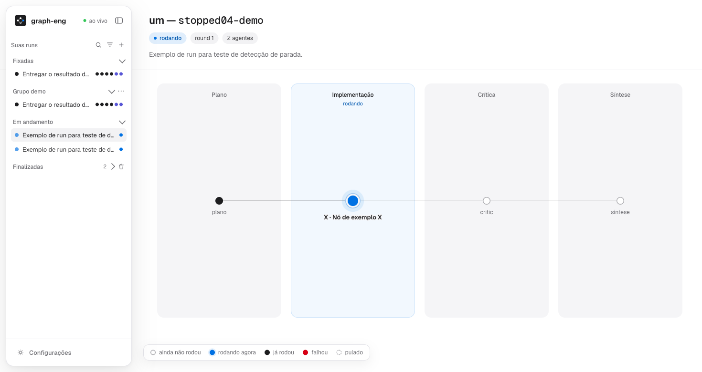
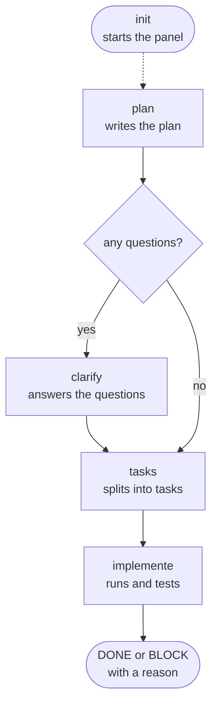
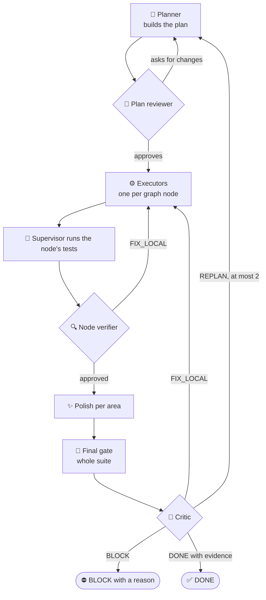
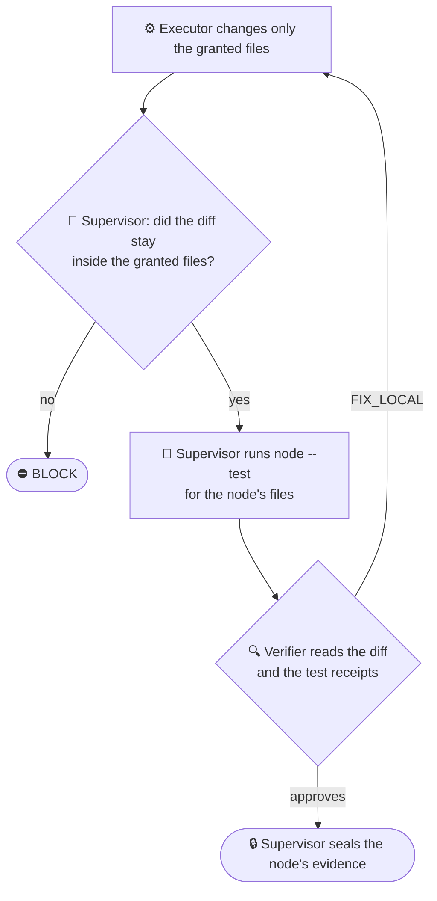

<p align="center">
  <picture>
    <source media="(prefers-color-scheme: dark)" srcset="docs/assets/logo-dark.svg">
    <source media="(prefers-color-scheme: light)" srcset="docs/assets/logo-light.svg">
    
  </picture>
</p>

<h1 align="center">graph-eng</h1>

<p align="center">
  <em>A complex task becomes a small graph of agents: reviewer feedback flows back through the graph, and the run only ends DONE with evidence.</em>
</p>

<p align="center">
  <a href="https://github.com/Dougladmo/graph-eng/stargazers"></a>
  <a href="CHANGELOG.md"></a>
  <a href="LICENSE"></a>
  <a href="#the-five-commands"></a>
  <a href="#the-five-commands"></a>
  <a href="#development"></a>
  <a href="#benchmark"></a>
</p>

<p align="center">
  <a href="#installation">Installation</a> ·
  <a href="#how-it-works">How it works</a> ·
  <a href="#benchmark">Benchmark</a> ·
  <a href="#the-five-commands">Commands</a> ·
  <a href="#final-state-in-the-panel">Panel</a> ·
  <a href="CHANGELOG.md">Changelog</a> ·
  <a href="skills/grapheng/DESIGN.md">Why the design is this way</a>
</p>

<p align="center">
  <strong>strong role plans and reviews · cheap role executes · real checks per node · DONE only with evidence · live panel</strong><br>
  <sub>graph-eng plans or runs complex tasks as small graphs, with roles set by the host, trusted checks and per-run evidence. The package keeps the <code>graph-eng</code> identity and finds <code>skills/</code> in a portable location.</sub>
</p>

<p align="center">
  <picture>
    <source media="(prefers-color-scheme: dark)" srcset="docs/assets/painel-dark.png">
    <source media="(prefers-color-scheme: light)" srcset="docs/assets/painel-light.png">
    
  </picture>
</p>

---

## In 30 seconds

> You describe the task. A **strong** model plans and reviews, **cheap** models do the work, and the supervisor runs **real tests** at every step. The run only ends as **DONE** when there is evidence; otherwise it stops with a **readable reason**.

| | |
| --- | --- |
| 🧠 **Plans strong** | The host's strong model builds the plan as a graph and reviews every stage. |
| ⚙️ **Executes cheap** | The host's operational model, cheaper, does the work of each node. |
| 🧪 **Checks with tests** | `node --test` on each node's files, and the whole suite at the end. |
| 🔁 **Fixes along the way** | Reviewer feedback flows back through the graph: redo a node, replan, or stop. |
| 🔒 **No false DONE** | Without passing tests, an approving critic and current evidence, DONE is denied. |

Current version: **1.0.0** · see the [CHANGELOG](CHANGELOG.md).

## Installation

In a Claude Code session, one command at a time:

```
/plugin marketplace add Dougladmo/graph-eng
```

```
/plugin install graph-eng@graph-eng
```

From the terminal:

```bash
claude plugin marketplace add Dougladmo/graph-eng
claude plugin install graph-eng@graph-eng
```

Requirements: `node` 22 on the `PATH`. The package has no runtime dependencies.

## The five commands

The normal path goes top to bottom. Each step reuses the previous one while it is still valid.



| Command | What it does | Touches code? |
| --- | --- | --- |
| `plan <task>` | Writes the plan. If information is missing, it ends with `needs_clarification`. | ❌ |
| `clarify` | Answers the plan's pending questions. It never makes up answers. | ❌ |
| `tasks` | Splits the approved plan into tasks (a dependency graph). | ❌ |
| `implemente [<task>]` | Runs the tasks, runs the tests and decides DONE or BLOCK. | ✅ |
| `init` | Starts (or reuses) the local panel and prints the port. | ❌ |

| Host | How to call it |
| --- | --- |
| Claude Code | `/graph-eng:plan <task>`, `/graph-eng:clarify`, `/graph-eng:tasks`, `/graph-eng:implemente [<task>]`, `/graph-eng:init` (or `/graph-eng:grapheng <command>`) |
| Codex | the `graph-eng:grapheng` skill, with the same five commands. Codex has no global slash command for the plugin |

Each repository has one plan slot and one tasks slot, the **current feature**: a newly approved `plan` replaces the previous one. If something changed since the previous step, the runner refuses to reuse it and says why (`workspace_changed`, `task_changed`, `tasks_plan_mismatch`, `source_unverified`, among others).

## How it works

### The whole cycle



### Who does what

Each role's model is fixed per host (Claude Code or Codex): strong to plan and review, operational to execute. There is no flag to change it.

| Role | Kind | What it does |
| --- | --- | --- |
| Planner | 🧠 strong | Builds the plan as a graph, with done criteria (`doneWhen`). |
| Reviewers (plan and design) | 🧠 strong | Approve, or send it back with the reason. |
| Critic | 🧠 strong | Checks every done criterion against the evidence and decides. |
| Executor | ⚙️ cheap | Does one node's work, only in the files granted to it. |
| Verifier | ⚙️ cheap | Reads what the executor did and the test receipts. |
| Synth | ⚙️ cheap | Writes the final summary. |
| Supervisor | 🧪 code | Runs the tests, seals the evidence and denies DONE without proof. It is not a model. |

### The four decisions

Every reviewer answers with one of these, always with evidence:

| Decision | What happens | Limit |
| --- | --- | --- |
| 🔧 `FIX_LOCAL` | Redoes only the affected node, with the reviewer's reason in the prompt. | counts against the node's budget |
| 🗺️ `REPLAN` | Writes a new plan. The user's done criteria stay locked. | at most 2 per run |
| ⛔ `BLOCK` | Stops and shows the reason (for example `original_plan_criteria_changed`). | — |
| ✅ `DONE` | Closes the run. Requires passing tests, an approving critic and current evidence. | denied without proof |

### How a node becomes done



Rules that always apply:

- A node only touches the files the plan granted to it. Any other file blocks it.
- The whole suite runs once, at the final gate, after all polish.
- Resuming never gives budget back, and counters never go down.

### What changed from 0.1 to 1.0

| | 0.1 | 1.0 |
| --- | --- | --- |
| Flow | one-way graph, with a critic at the end | **bidirectional** graph: feedback flows back and changes the plan |
| End of the run | `PARTIAL` report, without knowing if it finished | **DONE** with evidence, or **BLOCK** with a reason |
| Tests | free-form command per node | `node --test` selected by the node's files, whole suite at the end |
| Configuration | effort × agent cap, plus several fine-tuning knobs | only `--effort low\|medium\|max` |
| Hosts | Claude | Claude and Codex |
| Panel | view plus an action queue | live view, read only |

## Benchmark

`bin/graph-benchmark.mjs` runs a fixed task in a clean copy of the repository, with real Claude. The grade comes from a set of **external acceptance tests** that the agents never see. Every run is detailed in [docs/validation/graph-eng-2-benchmark.md](docs/validation/graph-eng-2-benchmark.md).

**Run f366:**

| | graph-eng 1.0 |
| --- | --- |
| 💵 Cost of the run | **$0.80** |
| ✅ External tests | **10/10** |
| 🏁 What the engine said | **DONE** with evidence |
| 🔒 False DONE | **no** |
| 📞 Model calls | 21 |
| 🔤 Tokens (input / output) | 605k / 36k |
| ⏱️ Engine time | 292 s |

**Where the money goes:**

| Role | Model | Calls | USD |
| --- | --- | --- | --- |
| 🧠 critic | strong | 2 | `██████` 0.31 |
| 🧠 planner | strong | 2 | `████` 0.18 |
| 🧠 plan reviewer | strong | 2 | `███` 0.17 |
| 🧠 design reviewer | strong | 1 | `██` 0.10 |
| ⚙️ executor | operational | 8 | 0.015 |
| 🔍 verifier | operational | 5 | 0.011 |
| ⚙️ synth | operational | 1 | 0.005 |
| **Total** | | **21** | **0.80** |

The strong model accounts for about 95% of the cost. The 14 operational-model calls add up to only 3 cents. Lowering the cost means working on the strong calls (critic, planner and reviewers), and that work is still open.

- 💰 Isolating the host cut the cost from about $88 to under $1 per run: the host stopped leaking about 75k tokens of context per call and now sends about 6.5k.
- 📈 Across 13 real runs, 1.0 never gave a false DONE. Every BLOCK became a fix with a regression test, until it closed DONE on f366.
- 🧪 The scenario is still simple. A harder scenario is missing.
- ⚠️ The real Codex host has not been validated yet.

## Execution details

Effort accepts `low`, `medium` (default) or `max`, in the separate form (`--effort max`); `--effort` overrides the configuration in `plan`, `clarify`, `tasks` and `implemente`. Roles and models are fixed by the trusted Claude or Codex adapter. There are no public flags for models, roles, width or internal limits.

The execution adapter in this release only supports the Node native test runner, in repositories with a readable `package.json` and `scripts.test` set to exactly `node --test`. Vitest, Jest, scripts with extra flags and repositories without that contract produce `BLOCK` for `implemente`; `plan` still works. Each node gets a local selection derived from the `inputs`, `outputs` and `files` the supervisor approved. A known internal mapping runs the affected tests; without a complete mapping, coverage is marked as limited and only the applicable `node --check` runs plus the contract and grant validation. The final gate runs the whole suite with concurrency 2, only after all polish. Checks use `process.execPath`, explicit argv and spawn without a shell. Each run writes its selection and receipts to `.graph-runs/` in the repository.

The runner reports the state and any blocks found during the run. When there is no trusted check mapping, `implemente` stays blocked; do not invent commands to get around it.

## Concurrency in the same repository

While an `implemente` runs in a repository, `plan`, `clarify` and `tasks` may be blocked with `workspace_busy`. That is expected: the workspace lock is the same for reading and writing, and it is only released when the run ends.

## Direct CLI (`bin/graph-run.mjs`)

Calling the runner directly is for debugging. `node bin/graph-run.mjs --host <claude|codex> --args <file.json>` blocks implementation without `nodeCheckPolicy` with `write_audit_unavailable`, without creating a host or runDir, and exits with code 2. Read-only plans (`planOnly`, `research`, `architecture`, `review`) pass without a policy.

Resuming through the direct CLI requires repeating `mode` and `nodeCheckPolicy` in the args. A file with only `{ "runId": "...", "resume": { ... } }` hits the same block, even if the original run had a policy.

## runDir integrity limits

The run writes its state to `.graph-runs/<runId>/` and checks the tree with an integrity guard. That guard has two known limits:

- **A violation does not persist after the process exits.** While the process that detected the change is alive, the run stays blocked with `run_integrity_violation` and does not write a REPORT. When the run is resumed later, the baseline is recomputed from the bytes currently on disk, and the resume accepts whatever is there.
- **While one host handle runs, another handle's output is not watched.** An agent with write access to the runDir can swap another handle's `.host-*.output.json` without the guard noticing, because the output has no hash. The schema is hashed and checked at cleanup.

A check error that is not a violation, such as an unreadable directory in the inventory, blocks with `integrity_check_failed`, even if the permission comes back before the run ends, and does not write a REPORT.

Cost: the whole-tree check runs per agent and costs O(runDir bytes). With a 1 to 10 MB runDir, each check takes 10 to 25 ms; above 100 MB this cost should be reassessed.

## Workspace lock with a dead owner

Each workspace has a resource lock in the state directory. If the run finds that lock with a dead owner, it does not remove it on its own: execution stops with `workspace_lock_owner_dead`, and the detail includes the file path and the owner's pid. A live pid with a different process identity (a reused pid) counts as a dead owner.

Manual removal: confirm the pid in the detail no longer exists, and only then delete the file shown. A lock with invalid JSON (`workspace_lock_invalid`) or an ambiguous owner (`workspace_lock_ambiguous`) also stays put for inspection and needs the same check before any removal.

## Memory across runs

At the end of each run with no integrity violation and a trusted lease (no heartbeat failure), the supervisor writes approved-design and valid-check records to the repository memory (`~/.claude/graph-eng/memory/<repoId>`, outside the runDir). A memory or record failure becomes a diagnostic in the journal and never changes the run's status.

A later run in the same repository selects those records by node and contract. Each worker only gets records for its own node with the same pre-work contract identity, in a `<memoryContext>` block warning that the content is untrusted data. The records come as JSON with `<` escaped, so a summary cannot close the tag or turn into an instruction. The `memory.selected` event shows up in the journal before the agent.

On resume, the run's pinned selection is reused only after it is checked. The `memory.selected` event is emitted again with `reused: true`, and the panel shows that mark. If the check fails, the run records a `selection_reuse_rejected` diagnostic and makes a new selection.

Limits of this version (v1.0):

- **The planner gets no memory selection.** It has no node or path defined at the start of the run, and selection needs a scope that matches some record.
- **The critic gets no memory selection.** The branch that selected by path had no record producer with paths; it was removed and is not relaxed. Memory records do not enter the critical review.
- **Final-phase evidence is left out.** Final check receipts (after polish) have no per-node scope and do not feed memory. Only node-phase receipts go in, scoped by `nodeId + contractIdentity`, and only the worker for the same node and contract receives them.
- **Contract, failure and version records are out of v1.0.** Those types exist in the record model, but no producer writes them and no role selects them. Nothing is fed without a consumer.

## Final state in the panel

The `run.finished` event is the last one in the journal and carries the terminal status. It is emitted after the REPORT and before the lease is released. A successful planOnly run records `plan_only` (plan finished), not `blocked`.

Known divergence: if releasing the lease or the workspace fails after `run.finished`, the journal keeps the result's status (for example `done`), while the CLI returns `blocked` with `lease_release_failed` or `workspace_release_failed`. The panel only shows the journal status once the lease has been released; with the lease stuck, the status is unknown.

## Development

The package needs no global install. With Node.js and the dev dependencies installed, run the driver and manifest tests:

```sh
node --test --test-concurrency=2 test/grapheng.test.mjs test/packaging.test.mjs
```

The project uses `node --test`; UI changes may need `npm run css:build`. The historical reasoning behind the design is in [DESIGN.md](skills/grapheng/DESIGN.md).

## License

[MIT](LICENSE)

## Star History

<a href="https://www.star-history.com/#Dougladmo/graph-eng&Date">
  <picture>
    <source media="(prefers-color-scheme: dark)" srcset="https://api.star-history.com/svg?repos=Dougladmo/graph-eng&type=Date&theme=dark">
    <source media="(prefers-color-scheme: light)" srcset="https://api.star-history.com/svg?repos=Dougladmo/graph-eng&type=Date">
    
  </picture>
</a>
