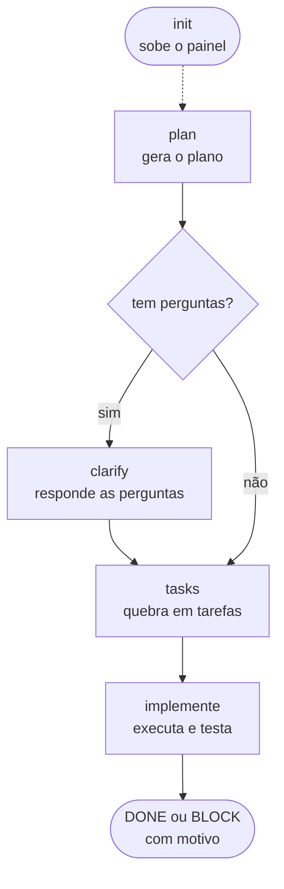
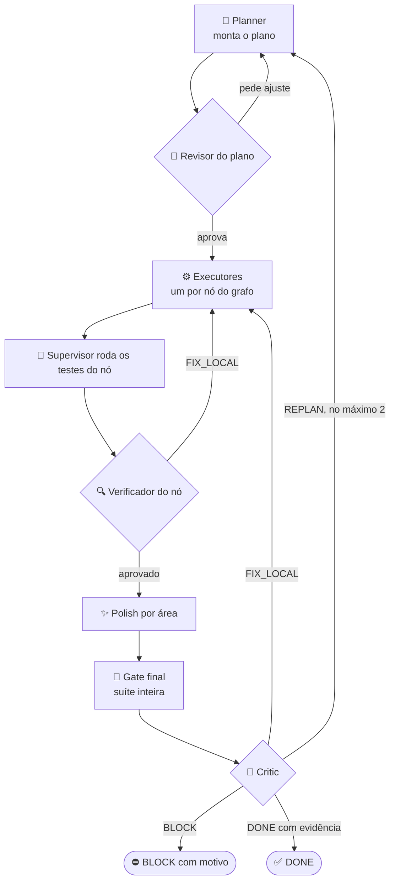
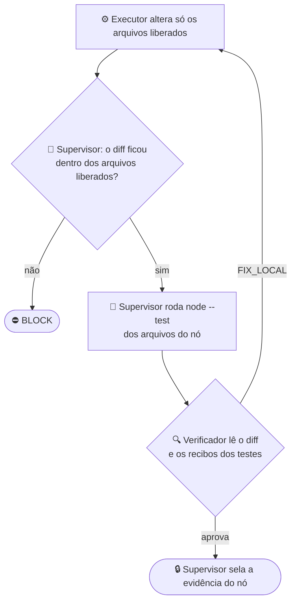

<p align="center">
  <picture>
    <source media="(prefers-color-scheme: dark)" srcset="docs/assets/logo-dark.svg">
    <source media="(prefers-color-scheme: light)" srcset="docs/assets/logo-light.svg">
    
  </picture>
</p>

<h1 align="center">graph-eng</h1>

<p align="center">
  <em>Tarefa complexa vira um grafo pequeno de agentes: o feedback dos revisores volta pelo grafo, e só sai DONE com evidência.</em>
</p>

<p align="center">
  <a href="https://github.com/Dougladmo/graph-eng/stargazers"></a>
  <a href="CHANGELOG.md"></a>
  <a href="LICENSE"></a>
  <a href="#os-cinco-comandos"></a>
  <a href="#os-cinco-comandos"></a>
  <a href="#desenvolvimento"></a>
  <a href="#benchmark"></a>
</p>

<p align="center">
  <a href="#instalação">Instalação</a> ·
  <a href="#como-funciona">Como funciona</a> ·
  <a href="#benchmark">Benchmark</a> ·
  <a href="#os-cinco-comandos">Comandos</a> ·
  <a href="#estado-final-no-painel">Painel</a> ·
  <a href="CHANGELOG.md">Changelog</a> ·
  <a href="skills/grapheng/DESIGN.md">Por que o desenho é este</a>
</p>

<p align="center">
  🌐 <a href="README.md">English</a> · <strong>Português</strong> · <a href="README.es.md">Español</a>
</p>

<p align="center">
  <strong>papel forte só revisa · papel médio planeja · papel barato executa · fluxo do tamanho da tarefa · checks reais por nó · DONE só com evidência · painel ao vivo</strong><br>
  <sub>O graph-eng planeja ou executa tarefas complexas como grafos pequenos, com papéis definidos pelo host, checks confiáveis e evidências por execução. O pacote mantém a identidade <code>graph-eng</code> e descobre <code>skills/</code> em local portátil.</sub>
</p>

<p align="center">
  <picture>
    <source media="(prefers-color-scheme: dark)" srcset="docs/assets/painel-dark.png">
    <source media="(prefers-color-scheme: light)" srcset="docs/assets/painel-light.png">
    
  </picture>
</p>

---

## Em 30 segundos

> Você descreve a tarefa. Um modelo **médio** planeja, o modelo **forte** só dá a revisão final, modelos **baratos** executam, e o supervisor roda **testes de verdade** em cada passo. A run só termina como **DONE** quando há evidência; senão, para com um **motivo legível**.
>
> A ideia: tarefas complexas sem pagar o preço do modelo forte em cada linha de trabalho. O modelo caro só pensa; o barato faz o volume. Veja [por que dividir os modelos](#benchmark).

| | |
| --- | --- |
| 🧠 **Revisa forte** | Um modelo médio monta o plano como grafo; o forte só carimba o plano e o design. Tarefa pequena pula a revisão pesada. |
| ⚙️ **Executa barato** | O modelo operacional do host, mais barato, faz o trabalho de cada nó. |
| 🧪 **Confere com testes** | `node --test` nos arquivos de cada nó e a suíte inteira no fim. |
| 🔁 **Corrige pelo caminho** | O feedback dos revisores volta pelo grafo: refaz um nó, replaneja ou para. |
| 🔒 **Sem DONE falso** | Sem testes aprovados, critic aprovado e evidência atual, o DONE é negado. |

Versão atual: **1.1.0** · veja o [CHANGELOG](CHANGELOG.md).

## Instalação

Numa sessão do Claude Code, um comando de cada vez:

```
/plugin marketplace add Dougladmo/graph-eng
```

```
/plugin install graph-eng@graph-eng
```

Pelo terminal:

```bash
claude plugin marketplace add Dougladmo/graph-eng
claude plugin install graph-eng@graph-eng
```

Requisitos: `node` 22 no `PATH`. O pacote não tem dependência de runtime.

## Os cinco comandos

O caminho normal é de cima para baixo. Cada passo reaproveita o anterior enquanto ele ainda vale.



| Comando | O que faz | Mexe no código? |
| --- | --- | --- |
| `plan <tarefa>` | Gera o plano. Se faltar informação, termina com `needs_clarification`. | ❌ |
| `clarify` | Responde as perguntas pendentes do plano. Não inventa respostas. | ❌ |
| `tasks` | Quebra o plano aprovado em tarefas (um grafo de dependências). | ❌ |
| `implemente [<tarefa>]` | Executa as tarefas, roda os testes e decide DONE ou BLOCK. | ✅ |
| `init` | Sobe (ou reaproveita) o painel local e mostra a porta. | ❌ |

| Host | Como chamar |
| --- | --- |
| Claude Code | `/graph-eng:plan <tarefa>`, `/graph-eng:clarify`, `/graph-eng:tasks`, `/graph-eng:implemente [<tarefa>]`, `/graph-eng:init` (ou `/graph-eng:grapheng <comando>`) |
| Codex | a skill `graph-eng:grapheng`, com os mesmos cinco comandos. Não há slash global do plugin no Codex |

Há um slot de plano e um de tarefas por repositório, a **feature corrente**: um `plan` aprovado novo substitui o anterior. Se algo mudou desde o passo anterior, o runner recusa o reuso e diz o motivo (`workspace_changed`, `task_changed`, `tasks_plan_mismatch`, `source_unverified`, entre outros).

## Como funciona

### O ciclo inteiro



### Quem faz o quê

O modelo de cada papel é fixo por host. Não há flag para trocar. O modelo forte só revisa: dá o carimbo final no plano e no design. O médio pensa, o barato faz o volume. Host com só dois modelos usa o forte nos papéis médios.

| Papel | Tipo | O que faz |
| --- | --- | --- |
| Pesquisadores | médio | Leem o código e, no Claude, a documentação atual na web. Rodam em paralelo. |
| Notetaker | ⚙️ barato | Junta as notas dos pesquisadores num resumo e aponta conflitos. |
| Planner | médio | Monta o plano como grafo, com critérios de pronto (`doneWhen`). |
| Revisor do plano | 🧠 forte | Aprova ou devolve com o motivo. |
| Designer | médio | Escreve o design dos nós que precisam de um. |
| Revisor do design | 🧠 forte | Aprova o design ou devolve. |
| Critic | médio | Confere cada critério de pronto contra a evidência e decide. |
| Executor | ⚙️ barato | Faz o trabalho de um nó, só nos arquivos liberados para ele. |
| Verificador | ⚙️ barato | Lê o que o executor fez e os recibos dos testes. |
| Synth | ⚙️ barato | Escreve o resumo final. |
| Supervisor | 🧪 código | Roda os testes, sela a evidência e nega DONE sem prova. Não é um modelo. |

Todo papel roda com esforço `medium`.

### Fluxo adaptativo

Nem toda tarefa precisa do ciclo inteiro. Antes de planejar, o runner faz a triagem da tarefa e escolhe um tier:

| Tier | Quando | O que roda |
| --- | --- | --- |
| ⚡ `fast` | mudança pequena e local, com check rodável | plano → implementação → verify → critic |
| ⚖️ `standard` | vários arquivos, ou domínio sensível (dinheiro, auth, dados de produção) | soma a revisão do plano pelo modelo forte |
| 🧭 `full` | tarefa ampla ou ambígua | soma pesquisa, design e a revisão do design pelo modelo forte |

Verify, checks e o critic final rodam em todo tier. O motor só sobe o tier (nó de design, nó de risco alto, plano grande), nunca desce. A decisão e os motivos vão para o journal da run. `--adaptive off` força o fluxo completo.

Classificador opcional: com uma chave do OpenRouter, um classificador externo pequeno (Jev 1.13, da TypeSafe) ajuda na triagem. Sem a chave, ou em qualquer falha, decide só a heurística. Para ligar, rode no seu terminal e cole a chave quando pedir:

```bash
node bin/graph-run.mjs triage-config
```

A chave fica em `~/.graph-eng/config.json` com permissão 0600 e nunca chega aos agentes.

### As quatro decisões

Todo revisor responde com uma destas, sempre com evidência:

| Decisão | O que acontece | Limite |
| --- | --- | --- |
| 🔧 `FIX_LOCAL` | Refaz só o nó afetado, com o motivo do revisor no prompt. | conta no orçamento do nó |
| 🗺️ `REPLAN` | Gera um plano novo. Os critérios de pronto do usuário ficam travados. | no máximo 2 por run |
| ⛔ `BLOCK` | Para e mostra o motivo (por exemplo `original_plan_criteria_changed`). | — |
| ✅ `DONE` | Fecha a run. Exige testes aprovados, critic aprovado e evidência atual. | negado sem prova |

### Como um nó vira pronto



Regras que valem sempre:

- O nó só mexe nos arquivos que o plano liberou para ele. Arquivo fora disso bloqueia.
- A suíte inteira roda uma vez, no gate final, depois de todo polish.
- A retomada nunca devolve orçamento, e os contadores nunca diminuem.

### O que mudou da 0.1 para a 1.0

| | 0.1 | 1.0 |
| --- | --- | --- |
| Fluxo | grafo de ida, com critic no fim | grafo **bidirecional**: o feedback volta e muda o plano |
| Fim da run | relatório `PARTIAL`, sem saber se terminou | **DONE** com evidência, ou **BLOCK** com motivo |
| Testes | comando livre por nó | `node --test` selecionado pelos arquivos do nó, suíte inteira no fim |
| Configuração | esforço × teto de agentes, mais vários ajustes finos | só `--effort low\|medium\|max` |
| Hosts | Claude | Claude e Codex |
| Painel | visualização e fila de ações | visualização ao vivo, só leitura |

## Benchmark

`bin/graph-benchmark.mjs` roda uma tarefa fixa numa cópia limpa do repositório, com Claude real. Quem dá a nota é um conjunto de **testes de aceitação externos**, que os agentes não veem. Detalhe de todas as rodadas em [docs/validation/graph-eng-2-benchmark.md](docs/validation/graph-eng-2-benchmark.md).

**Rodada f366:**

| | graph-eng 1.0 |
| --- | --- |
| 💵 Custo da rodada | **US$ 0,80** |
| ✅ Testes externos | **10/10** |
| 🏁 O que o motor disse | **DONE** com evidência |
| 🔒 DONE falso | **não** |
| 📞 Chamadas de modelo | 21 |
| 🔤 Tokens (entrada / saída) | 605k / 36k |
| ⏱️ Tempo do motor | 292 s |

**Onde vai o dinheiro:**

| Papel | Modelo | Chamadas | US$ |
| --- | --- | --- | --- |
| 🧠 critic | forte | 2 | `██████` 0,31 |
| 🧠 planner | forte | 2 | `████` 0,18 |
| 🧠 revisor do plano | forte | 2 | `███` 0,17 |
| 🧠 revisor do design | forte | 1 | `██` 0,10 |
| ⚙️ executor | operacional | 8 | 0,015 |
| 🔍 verificador | operacional | 5 | 0,011 |
| ⚙️ synth | operacional | 1 | 0,005 |
| **Total** | | **21** | **0,80** |

O modelo forte responde por cerca de 95% do custo. As 14 chamadas do modelo operacional somam só 3 centavos. Para baixar o custo, o lugar é nas chamadas fortes (critic, planner e revisores), e esse trabalho segue em aberto.

**Por que dividir os modelos:**

Nesta run, cada token do modelo forte custou cerca de **40×** o token do operacional. É essa diferença de preço que o graph-eng usa: o modelo forte só pensa (plano, revisão, veredito final), e o operacional faz o volume do trabalho.

| Mesmas 21 chamadas, mesmos tokens | USD |
| --- | --- |
| ✅ graph-eng 1.0: forte planeja e revisa, operacional executa (medido) | `████` **0,80** |
| 🧠 Todas as chamadas no modelo forte (estimativa) | `██████████` 1,99 |

Rodar as chamadas de executor, verifier e synth no modelo forte custaria cerca de **2,5× mais**. A estimativa reprecifica os tokens que cada chamada usou de verdade pela tarifa do modelo forte. Um agente único fazendo a tarefa inteira sozinho não usaria os mesmos tokens, e esse baseline ainda não foi medido. A Anthropic relatou o mesmo padrão no seu [sistema de pesquisa multiagente](https://www.anthropic.com/engineering/multi-agent-research-system): um agente líder forte com subagentes mais leves superou um agente forte sozinho em 90,2% na avaliação interna de pesquisa.

- 💰 O isolamento do host derrubou o custo de cerca de US$ 88 para menos de US$ 1 por rodada: o host deixou de vazar cerca de 75k tokens de contexto por chamada e agora manda cerca de 6,5k.
- 📈 Em 13 rodadas reais, a 1.0 nunca deu DONE falso. Cada BLOCK virou correção com teste de regressão, até fechar DONE na f366.
- 🧪 O cenário ainda é simples. Falta um cenário mais difícil.
- ⚠️ O host Codex real ainda não foi validado.

## Detalhes de execução

O esforço aceita `low`, `medium` (padrão) ou `max`, na forma separada (`--effort max`); `--effort` substitui a configuração em `plan`, `clarify`, `tasks` e `implemente`. Papéis e modelos são fixos pelo adapter confiável de Claude ou Codex. Não há flags públicas para modelos, papéis, largura ou limites internos. `--adaptive on|off` (padrão `on`) liga ou desliga os tiers; ver [Fluxo adaptativo](#fluxo-adaptativo).

O adapter de execução implementado neste corte é somente Node native test runner em repositórios com `package.json` legível e `scripts.test` exatamente `node --test`. Vitest, Jest, scripts com flags extras e repositórios sem esse contrato produzem `BLOCK` para `implemente`; `plan` continua disponível. Cada nó recebe uma seleção local derivada de `inputs`, `outputs` e `files` aprovados pelo supervisor. Um mapping interno conhecido roda os testes afetados; sem mapping completo, a cobertura é marcada como limitada e só se executam `node --check` aplicáveis e a validação do contrato/grants. O gate final roda a suíte completa com concorrência 2 somente depois de todo polish. Os checks usam `process.execPath`, argv explícito e spawn sem shell. Cada run grava seleção e receipts em `.graph-runs/` no repositório.

O runner informa o estado e os bloqueios encontrados durante a execução. Quando não há mapeamento confiável de checks, `implemente` fica bloqueado; não invente comandos para contornar isso.

## Concorrência no mesmo repositório

Enquanto um `implemente` roda no mesmo repositório, `plan`, `clarify` e `tasks` podem ser bloqueados com `workspace_busy`. Isso é esperado: o lock do workspace é o mesmo para leitura e escrita, e só sai quando a run termina.

## CLI direto (`bin/graph-run.mjs`)

O uso direto do runner é para depuração. `node bin/graph-run.mjs --host <claude|codex> --args <arquivo.json>` bloqueia implementação sem `nodeCheckPolicy` com `write_audit_unavailable`, sem criar host nem runDir, e sai com código 2. Plano só de leitura (`planOnly`, `research`, `architecture`, `review`) passa sem política.

Retomar pelo CLI direto exige repetir `mode` e `nodeCheckPolicy` nos args. Um arquivo só com `{ "runId": "...", "resume": { ... } }` cai no mesmo bloqueio, mesmo que a run original tenha política.

## Limites de integridade da runDir

A run grava o estado em `.graph-runs/<runId>/` e confere a árvore com um guard de integridade. Esse guard tem dois limites conhecidos:

- **A violação não persiste depois que o processo sai.** Enquanto o processo que detectou a alteração está vivo, a run fica bloqueada com `run_integrity_violation` e não escreve REPORT. Quando a run é retomada depois, o baseline é recalculado a partir dos bytes atuais do disco, e o resume aceita o que estiver lá.
- **Durante o handle de um host, a saída de outro handle não é vigiada.** Um agente com escrita na runDir pode trocar o `.host-*.output.json` de outro handle sem que o guard perceba, porque a saída não tem hash. O schema tem hash e é conferido na limpeza.

Um erro de checagem que não é violação, como um diretório ilegível no inventário, bloqueia com `integrity_check_failed`, mesmo que a permissão volte antes do fim da run, e não grava REPORT.

Custo: a checagem da árvore inteira roda por agente e custa O(bytes da runDir). Com runDir de 1 a 10 MB, cada checagem leva de 10 a 25 ms; acima de 100 MB, esse custo deve ser reavaliado.

## Lock de workspace com dono morto

Cada workspace tem um lock de recurso no diretório de estado. Se a run encontra esse lock com dono morto, ela não o remove sozinha: a execução para com `workspace_lock_owner_dead`, e o detalhe traz o caminho do arquivo e o pid do dono. Um pid vivo com outra identidade de processo (pid reutilizado) conta como dono morto.

Remoção manual: confirme que o pid do detalhe não existe mais e só então apague o arquivo indicado. Um lock com JSON inválido (`workspace_lock_invalid`) ou com dono ambíguo (`workspace_lock_ambiguous`) também fica parado para inspeção e exige a mesma conferência antes de qualquer remoção.

## Memória entre runs

Ao fim de cada run sem violação de integridade e com lease confiável (sem falha de heartbeat), o supervisor registra na memória do repositório (`~/.claude/graph-eng/memory/<repoId>`, fora da runDir) os registros de design aprovado e de checks válidos. Falha de memória ou de registro vira diagnóstico no journal e nunca muda o status da run.

Uma run seguinte no mesmo repositório seleciona esses registros por nó e contrato. Cada worker recebe só os registros do próprio nó e com a mesma identidade de contrato pré-trabalho, num bloco `<memoryContext>` com o aviso de que o conteúdo são dados não confiáveis. Os registros vêm como JSON, com `<` escapado, então um resumo não consegue fechar a tag nem virar instrução. O evento `memory.selected` aparece no journal antes do agente.

Na retomada, a seleção fixada da run é reaproveitada só depois de conferida. O evento `memory.selected` sai de novo com `reused: true`, e o painel mostra essa marca. Se a conferência falhar, a run registra um diagnóstico `selection_reuse_rejected` e faz uma nova seleção.

Limitações desta versão (v1.0):

- **O planner não recebe seleção de memória.** Ele não tem nó nem caminho definidos no início da run, e a seleção exige um escopo que case com algum registro.
- **O critic não recebe seleção de memória.** O ramo que selecionava por caminho não tinha produtor de registro com caminhos; foi retirado e não é relaxado. Registros de memória não entram na revisão crítica.
- **Evidência da fase final fica fora.** Receipts de checks finais (depois do polish) não têm escopo por nó e não alimentam a memória. Só os receipts da fase de nó entram, com escopo `nodeId + contractIdentity`, e só o worker do mesmo nó e contrato os recebe.
- **Contract, failure e version ficam fora da v1.0.** Esses tipos existem no modelo de registro, mas nenhum produtor os grava e nenhum papel os seleciona. Nada é alimentado sem consumidor.

## Estado final no painel

O evento `run.finished` é o último do journal e carrega o status terminal. Ele sai depois do REPORT e antes da liberação do lease. Uma run planOnly bem-sucedida grava `plan_only` (plano concluído), não `blocked`.

Divergência conhecida: se a liberação do lease ou do workspace falha depois do `run.finished`, o journal continua com o status do resultado (por exemplo `done`), enquanto o retorno do CLI sai `blocked` com `lease_release_failed` ou `workspace_release_failed`. O painel só mostra o status do journal quando o lease já foi solto; com o lease preso, o status fica desconhecido.

## Desenvolvimento

O pacote não precisa de instalação global. Com Node.js e dependências de desenvolvimento já instaladas, execute os testes do driver e dos manifests:

```sh
node --test --test-concurrency=2 test/grapheng.test.mjs test/packaging.test.mjs
```

O projeto usa `node --test`; alterações de UI podem exigir `npm run css:build`. A justificativa histórica do desenho está em [DESIGN.md](skills/grapheng/DESIGN.md).

## Licença

[MIT](LICENSE)

## Star History

<a href="https://www.star-history.com/#Dougladmo/graph-eng&Date">
  <picture>
    <source media="(prefers-color-scheme: dark)" srcset="https://api.star-history.com/svg?repos=Dougladmo/graph-eng&type=Date&theme=dark">
    <source media="(prefers-color-scheme: light)" srcset="https://api.star-history.com/svg?repos=Dougladmo/graph-eng&type=Date">
    
  </picture>
</a>
