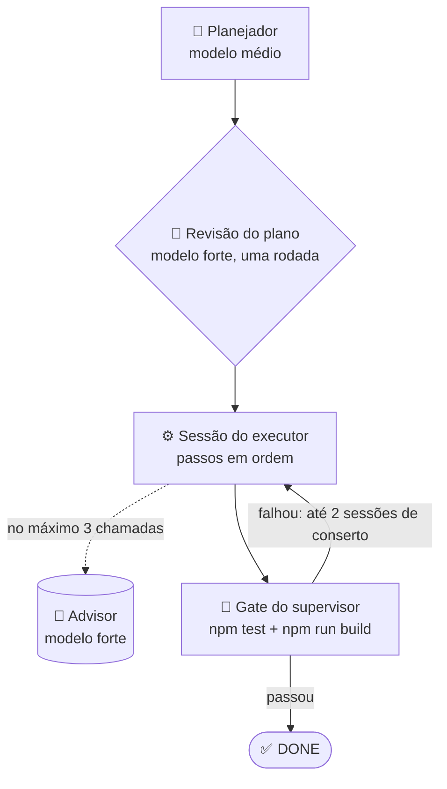

<p align="center">
  <picture>
    <source media="(prefers-color-scheme: dark)" srcset="docs/assets/logo-dark.svg">
    <source media="(prefers-color-scheme: light)" srcset="docs/assets/logo-light.svg">
    
  </picture>
</p>

<h1 align="center">graph-eng</h1>

<p align="center">
  <em>Um modelo médio planeja, o forte revisa e aconselha, um barato faz os passos simples, e a run só fecha DONE quando os testes e o build passam.</em>
</p>

<p align="center">
  <a href="https://github.com/Dougladmo/graph-eng/stargazers"></a>
  <a href="CHANGELOG.md"></a>
  <a href="LICENSE"></a>
  <a href="#comandos"></a>
  <a href="#comandos"></a>
  <a href="#desenvolvimento"></a>
  <a href="#benchmark"></a>
</p>

<p align="center">
  <a href="#primeiros-passos">Primeiros passos</a> ·
  <a href="#como-funciona">Como funciona</a> ·
  <a href="#comandos">Comandos</a> ·
  <a href="#flags">Flags</a> ·
  <a href="#benchmark">Benchmark</a> ·
  <a href="CHANGELOG.md">Changelog</a>
</p>

<p align="center">
  🌐 <a href="README.md">English</a> · <strong>Português</strong> · <a href="README.es.md">Español</a>
</p>

---

## Em 30 segundos

> Você descreve a tarefa. Um modelo **médio** escreve o plano, o modelo **forte** revisa uma vez e fica de plantão como **advisor**, e o trabalho roda numa **sessão contínua**: o modelo **barato** pega os passos simples e repetitivos e o médio pega o resto. No fim, o supervisor roda `npm test` e `npm run build` ele mesmo. A run só fica **DONE** se os dois passarem; senão ela para com um **motivo legível**.

| | |
| --- | --- |
| 🧠 **Forte só revisa e aconselha** | Uma revisão do plano e no máximo 3 chamadas de advisor por run. |
| 📝 **Médio planeja e faz os passos difíceis** | Escreve o plano, marca a complexidade de cada passo e executa os passos `medium` e `high`. |
| ⚙️ **Barato faz os passos simples** | Os passos marcados `low` vão para o modelo barato por padrão. |
| 🧪 **Gate real** | `npm test` e `npm run build`, rodados pelo supervisor, decidem o DONE. |
| 💰 **Mais barato e mais rápido** | Mesma nota de um agente único no modelo forte por cerca de um quarto do custo, em menos da metade do tempo ([benchmark](#benchmark)). |

Versão atual: **1.3.0** · veja o [CHANGELOG](CHANGELOG.md).

## Instalação

Numa sessão do Claude Code, um comando por vez:

```
/plugin marketplace add Dougladmo/graph-eng
```

```
/plugin install graph-eng@graph-eng
```

Pelo terminal:

```bash
claude plugin marketplace add Dougladmo/graph-eng
claude plugin install graph-eng@graph-eng
```

Requisitos: `node` 22 no `PATH` e um repositório com script `test` no `package.json` (o gate roda ele). O pacote não tem dependências de runtime.

## Primeiros passos

Cole isto no Claude Code, dentro do seu repositório, e troque a tarefa (o prompt é em inglês para funcionar em qualquer projeto):

```
Use graph-eng 1.3 (advisor flow) for this task. First run /graph-eng:plan with it and show me the plan; after I approve, run /graph-eng:implemente with no arguments.

Task: <describe what you want built or changed>
```

Ou pule a revisão e rode tudo de uma vez:

```
/graph-eng:implemente <sua tarefa>
```

## Como funciona



1. **Plano.** O planejador (modelo médio, só leitura) lê o repositório e escreve os passos, cada um marcado `low`, `medium` ou `high`, e o que significa "pronto".
2. **Revisão.** O modelo forte revisa o plano uma vez. Se pedir mudanças, as notas vão direto para o executor; não há segunda rodada.
3. **Execução.** O executor trabalha numa sessão contínua, então mantém o contexto de um passo para o outro. Quando trava, pode pedir conselho ao modelo forte, no máximo 3 vezes por run. O shell dele só roda `npm test` e `npm run build`.
4. **Gate.** O supervisor roda `npm test` e `npm run build` ele mesmo. Se algum falhar, o executor recebe a saída da falha numa sessão nova, até 2 sessões de conserto, sempre no modelo médio.

**Quem faz o quê por padrão (host Claude):**

| Papel | Modelo | Por quê |
| --- | --- | --- |
| Revisão do plano e advisor | 🧠 forte | Julgamento onde importa, poucas chamadas |
| Planejador | 📝 médio | Lê o código e escreve os passos |
| Passos `medium` e `high`, consertos do gate | 📝 médio | O trabalho de verdade |
| Passos `low` | ⚙️ barato | Trabalho simples e repetitivo |

Passos seguidos no mesmo modelo dividem uma sessão. O orçamento do advisor é compartilhado entre as sessões.

## Comandos

| Comando | O que faz | Mexe no código? |
| --- | --- | --- |
| `plan <tarefa>` | Escreve e revisa o plano, mostra a complexidade de cada passo e qual modelo pega cada um, e salva em `.graph-runs/advisor-plan.json`. | ❌ |
| `implemente <tarefa>` | Faz tudo numa run: plano, revisão, execução e gate. | ✅ |
| `implemente` | Executa o último plano salvo pelo `plan`, com o roteamento escolhido lá. | ✅ |

| Host | Como chamar |
| --- | --- |
| Claude Code | `/graph-eng:plan <tarefa>`, `/graph-eng:implemente [<tarefa>]` (ou `/graph-eng:grapheng <comando>`) |
| Codex | a skill `graph-eng:grapheng`, com os mesmos dois comandos. O Codex não tem slash global para o plugin |

## Flags

Sempre na forma separada (`--effort max`, nunca `--effort=max`).

| Flag | Valores | Padrão | O que faz |
| --- | --- | --- | --- |
| `--effort` | `low`, `medium`, `max` | `medium` | Esforço de raciocínio de todas as chamadas da run. |
| `--haiku-max` | `low`, `medium`, `off` | `low` no Claude | Complexidade máxima de passo que vai para o modelo barato. `off` deixa todos os passos no médio. |
| `--executor` | `sonnet`, `haiku` | nenhum | Um modelo para todos os passos. Desliga o roteamento e não combina com `--haiku-max`. |

`--haiku-max` e `--executor` só existem no host Claude; no Codex o fluxo não roteia. Em `implemente` sem tarefa, o roteamento vem do plano salvo, então passe essas duas flags no `plan`.

Exemplos:

```
/graph-eng:implemente adicionar modo escuro na página de configurações --effort max
```

```
/graph-eng:plan migrar os helpers de data para Temporal --haiku-max medium
```

## Resultados e bloqueios

| Status | Significado |
| --- | --- |
| `planned` | O `plan` terminou e o plano foi salvo. |
| `done` | O gate passou e o executor declarou todos os passos prontos. |
| `blocked` | A run parou. O motivo vem junto. |

Motivos de bloqueio: `advisor_gate_missing_test` (sem script `test` no `package.json`), `advisor_plan_missing` (`implemente` sem tarefa e sem plano salvo), `advisor_plan_host_mismatch` (plano salvo de outro host), `advisor_gate_failed` (testes ou build ainda falhando depois dos consertos), `advisor_executor_blocked` (o gate passou, mas o executor declarou um passo bloqueado), `advisor_call_failed` (uma chamada de modelo falhou).

Cada run deixa a evidência em `.graph-runs/<runId>/advisor-run.json`: plano, revisão, roteamento, sessões, saída do gate, chamadas e custo por modelo e por papel.

## Benchmark

**Minecraft MVP (22 e 23/10/2026):** um clone jogável do Minecraft em React e three.js, a partir de um esqueleto vazio. A nota vem de **55 testes de aceite ocultos** que os agentes nunca veem, mais `npm run build` e uma checagem visual no navegador (criar mundo, andar, minerar, colocar bloco, abrir o inventário). Uma run por variante, Claude real.

| Variante | Testes ocultos | Custo | Tempo |
| --- | --- | --- | --- |
| 🧠 Agente único no modelo forte, sem graph-eng | 55/55 | US$ 5,97 | 23 min |
| Advisor, modelo médio executa tudo (`--executor sonnet`) | 55/55 | US$ 1,79 | 11 min |
| Advisor, modelo barato executa tudo (`--executor haiku`) | 54/55 | US$ 2,33 | 20 min |
| Advisor, modelo barato em `low` + `medium` (`--haiku-max medium`) | 55/55 | US$ 1,66 | 12,5 min |
| ✅ Advisor, modelo barato em `low` (padrão) | **55/55** | **US$ 1,59** | **10 min** |

- 💰 O padrão tirou a mesma nota do agente único no modelo forte por **cerca de um quarto do custo** (US$ 1,59 contra US$ 5,97), em **menos da metade do tempo**. Todas as variantes do advisor mostraram o jogo na tela sem erro no console.
- 🐢 O modelo barato sozinho na tarefa inteira foi mais lento e mais caro: chamou o advisor uma vez (US$ 1,21) e ainda falhou um teste de física. Por isso ele só pega os passos simples.
- ✂️ Dividido por passo, o modelo barato deu conta de tudo que recebeu. Com `medium` ele pegou 4 de 10 passos por US$ 0,06, sem erro.
- ⚠️ O roteamento só economizou de 7% a 11% aqui, porque o planejador marcou 6 de 10 passos como `high`. Com uma run de cada, 10% de diferença está dentro da variação normal.

**Para onde foi o dinheiro na run padrão (US$ 1,59):**

| Papel | Modelo | USD |
| --- | --- | --- |
| 📝 Planejador | médio | `█` 0,14 |
| 🧠 Revisão do plano | forte | `█` 0,15 |
| ⚙️ Sessões do executor (passos `medium`/`high`) | médio | `████████` 1,29 |
| ⚙️ Sessões do executor (passos `low`) | barato | 0,01 |
| 🧠 Advisor | forte | 0 (não foi chamado) |

O modelo forte custou menos de 10% da run. A evidência bruta de cada run está em [docs/benchmarks/](docs/benchmarks/).

### Por que o motor de grafo saiu

Até a 1.2, o graph-eng também tinha um fluxo de grafo: a tarefa virava um grafo de nós, cada um rodado por um agente barato separado, com verificadores, critic e revisores no meio. Em tarefa pequena funcionava, mas na tarefa do Minecraft ele levou 5 tentativas, gastou US$ 7,58 e nunca entregou um jogo funcionando. Cada nó começava sem o contexto dos outros, e as camadas de revisão custavam mais que o próprio trabalho. O fluxo advisor mantém a parte boa (o modelo forte só pensa, os mais baratos fazem o volume, um gate real decide o DONE) numa sessão contínua. Na 1.3.0 saíram o motor de grafo, os comandos `clarify`, `tasks` e `init`, `--adaptive`, `--flow` e o painel local.

## Desenvolvimento

O pacote não precisa de instalação. Rode os testes com:

```sh
node --test --test-concurrency=2
```

## Licença

[MIT](LICENSE)

## Star History

<a href="https://www.star-history.com/#Dougladmo/graph-eng&Date">
  <picture>
    <source media="(prefers-color-scheme: dark)" srcset="https://api.star-history.com/svg?repos=Dougladmo/graph-eng&type=Date&theme=dark">
    <source media="(prefers-color-scheme: light)" srcset="https://api.star-history.com/svg?repos=Dougladmo/graph-eng&type=Date">
    
  </picture>
</a>
