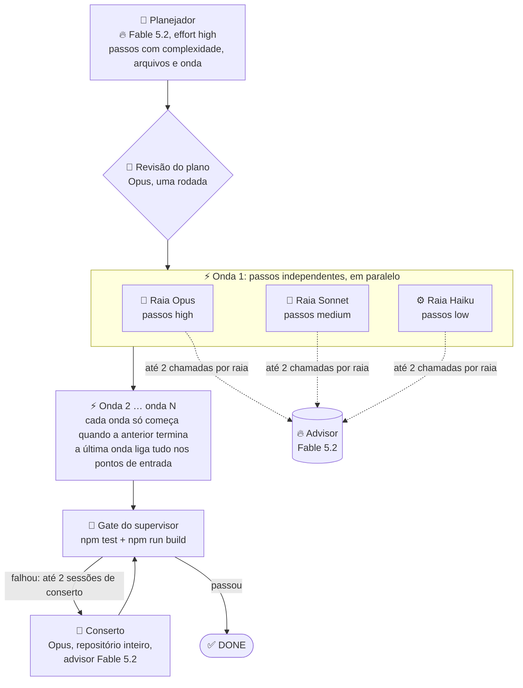

# Power Mode (graph-eng 1.4)

**Em uma frase:** o modelo mais forte da família (Fable 5.2) pensa, os outros digitam em paralelo, e o gate continua decidindo o DONE.

O fluxo advisor da 1.3 já tinha a ideia certa: o modelo forte só revisa e aconselha, os mais baratos fazem o volume, e `npm test` + `npm run build` decidem o fim. O Power Mode leva isso ao limite em duas direções ao mesmo tempo:

1. **Inteligência onde ela paga.** O Fable 5.2 escreve o plano e fica de plantão como advisor. O plano é o que mais influencia a run inteira (o que cada sessão faz, em que ordem, em que arquivo), e o advisor é quem desbloqueia quando a sessão trava. São poucas chamadas, com o contexto inteiro, então é aqui que o modelo mais caro faz diferença.
2. **Velocidade onde ela é de graça.** O plano sai dividido em **ondas**. Dentro de uma onda, os passos são independentes e tocam arquivos diferentes, então rodam ao mesmo tempo, em **raias** separadas por modelo: o forte (Opus) pega os passos `high`, o médio (Sonnet) os `medium`, o barato (Haiku) os `low`. Três sessões em paralelo, cada uma com o repositório inteiro, nenhuma esperando a outra.

Nada do que já funciona muda: isolamento do ambiente, shell só com os comandos do gate, gate externo do supervisor, sessões de conserto, evidência em `advisor-run.json`.

## Diagrama



## Quem faz o quê

| Papel | Padrão (1.3) | Power (1.4) | Por quê |
| --- | --- | --- | --- |
| Planejador | 📝 médio (Sonnet) | 🔥 **Fable 5.2**, effort `high` | O plano define ondas, arquivos e complexidade; erro aqui vira retrabalho em todas as raias |
| Revisão do plano | 🧠 forte (Opus) | 🧠 forte (Opus) | Segunda opinião de outro modelo, barata; o Fable revisar o próprio plano acrescenta pouco |
| Advisor | 🧠 forte (Opus) | 🔥 **Fable 5.2** | Quem desbloqueia a sessão travada, vendo a transcrição inteira |
| Passos `high` | 📝 médio | 🧠 **forte (Opus)** | Algoritmo, caso de borda, integração: o Opus é rápido o bastante e mais confiável que o Sonnet |
| Passos `medium` | 📝 médio | 📝 médio (Sonnet) | Lógica contida com contrato claro |
| Passos `low` | ⚙️ barato | ⚙️ barato (Haiku) | Tabela, constante, CSS, ligação simples |
| Conserto do gate | 📝 médio | 🧠 **forte (Opus)** + advisor Fable | O conserto vê o repositório inteiro e a saída do gate; é a hora de não economizar |

Com `--fable-min high`, os passos `high` vão para o próprio Fable 5.2 em vez do Opus. É a variante "potência máxima", para o benchmark decidir se vale o custo.

## A lógica das ondas e raias

O planejador do Power Mode devolve, para cada passo:

```json
{ "step": "world.js: chunks, terreno, árvores, minério, edições e serialização", "complexity": "high", "files": ["src/engine/world.js"], "wave": 2 }
```

- **`wave`** diz quando o passo roda. Um passo só pode depender de passos de ondas anteriores. A onda 1 tem as fundações independentes; a última onda liga tudo nos pontos de entrada.
- **`files`** diz a pegada do passo. É o que torna o paralelismo seguro: duas sessões nunca editam o mesmo arquivo ao mesmo tempo.

O runner não confia cegamente no plano:

1. **Ondas com conflito de arquivo são divididas.** Se dois passos da mesma onda listam o mesmo arquivo (ou um passo não lista arquivo nenhum), o segundo vai para uma sub-onda seguinte. A ordem relativa dos passos nunca muda. Passo sem `wave` válida herda a onda do passo anterior.
2. **Dentro da onda, os passos viram raias por modelo.** Todos os `high` da onda numa sessão do Opus, todos os `medium` numa do Sonnet, todos os `low` numa do Haiku. No máximo três sessões ao mesmo tempo, cada uma com contexto contínuo entre os seus passos.
3. **As raias rodam em paralelo; as ondas, em série.** A onda seguinte só começa quando todas as raias da anterior terminaram, então ela já encontra o trabalho anterior na árvore de trabalho.
4. **Cada raia sabe que não está sozinha.** O prompt diz quais passos são dela, que outras sessões estão mexendo nos outros arquivos agora, que ela não deve criar nem editar arquivo fora da pegada dos seus passos, e que falha de teste em arquivo de outro passo não é dela.
5. **O gate roda uma vez, no fim de todas as ondas.** Se falhar, uma sessão de conserto inteira no Opus (repositório todo, advisor Fable), até 2 vezes, como hoje.

**Exemplo com o benchmark Minecraft** (10 passos do plano da 1.3):

| Onda | Raia Opus (`high`) | Raia Sonnet (`medium`) | Raia Haiku (`low`) |
| --- | --- | --- | --- |
| 1 | — | `noise.js` | `blocks.js`, `daynight.js` |
| 2 | `world.js`, `physics.js`, `mesher.js` | `raycast.js`, `inventory.js`, `crafting.js` | `mining.js` |
| 3 | render e mundo em chunks (`src/render/`) | HUD, menu, inventário (`src/ui/`) | — |
| 4 | `main.jsx`: ligar tudo | — | — |

Na run padrão da 1.3, as sessões do executor foram 80% dos 617 s, em série. Com três raias, a onda 2 roda no tempo da raia mais lenta, não na soma das três.

## Orçamento do advisor e esforço

- **Advisor:** 6 chamadas por run no Power Mode (contra 3 no padrão), com teto de 2 por sessão de raia. Cada raia recebe o saldo que sobrou no começo da onda; o que ela gastou é contado na transcrição da sessão, como hoje.
- **Esforço:** as chamadas do Fable (planejador) sobem para `high` quando `--effort` é `low` ou `medium`; `--effort max` vale `max` para todos. As raias usam o `--effort` da run.

## Flags

| Flag | Valores | O que faz |
| --- | --- | --- |
| `--power` | — | Liga o Power Mode. Só no host Claude. Não combina com `--executor`. |
| `--fable-min` | `high`, `off` (padrão `off`) | Com `high`, os passos `high` vão para o Fable 5.2 em vez do Opus. Exige `--power`. |
| `--haiku-max` | `low`, `medium`, `off` | Continua valendo: complexidade máxima que vai para o barato. Com `off`, os passos `low` vão para o Sonnet. |
| `--effort` | `low`, `medium`, `max` | Continua valendo para todas as chamadas; o Fable tem piso `high`. |

`plan --power` salva o modo no plano; `implemente` sem tarefa reaplica. Como hoje, as flags de roteamento vão no `plan`.

## Evidência

`advisor-run.json` ganha `power: true`, `fableMin`, e `routing` vira a lista de ondas:

```json
"routing": [
  { "wave": 1, "lanes": [{ "model": "sonnet", "steps": [2] }, { "model": "haiku", "steps": [1, 3] }] },
  { "wave": 2, "lanes": [{ "model": "opus", "steps": [4, 5, 6] }, { "model": "sonnet", "steps": [7, 8, 9] }, { "model": "haiku", "steps": [10] }] }
]
```

Cada sessão registra `wave`, `model`, `steps`, `status`, `summary`, `sessionId`, `advisorCalls` e `ms`. O custo continua dividido por modelo e por papel, então dá para ver exatamente quanto o Fable custou.

## O que o benchmark precisa responder

As runs reais só podem rodar depois do reset semanal de uso (12/11 às 12h, horário de Belém). Até lá, tudo roda com host falso nos testes. Variantes, uma run de cada, no mesmo esqueleto do Minecraft (`test/fixtures/benchmark-minecraft/bench.sh`):

| Variante | Comando | Hipótese |
| --- | --- | --- |
| Padrão 1.3 (referência) | já medido: 55/55, US$ 1,59, 617 s | — |
| Power | `--power` | 55/55, tempo bem abaixo de 617 s, custo entre US$ 2 e 4 (Fable no plano, Opus nos `high`) |
| Power, potência máxima | `--power --fable-min high` | 55/55, mais caro; só vale se o Opus falhar algum teste ou precisar de conserto |
| Power, barato até `medium` | `--power --haiku-max medium` | custo menor; risco no 54/55 que o Haiku já teve em física |

O que medir em cada uma: testes ocultos (55), build, smoke visual, custo total e por modelo, tempo total e por onda, chamadas ao advisor, sessões de conserto. A variante que mantém 55/55 com o menor tempo vira o Power Mode padrão; o Fable nos `high` só fica se mudar a nota.

## Riscos e o que segura cada um

| Risco | O que segura |
| --- | --- |
| Duas raias editam o mesmo arquivo | Pegada por passo validada antes de rodar; conflito divide a onda |
| Raia depende de passo da mesma onda | O prompt do planejador proíbe; o conserto no Opus pega o que escapar |
| `npm test` de uma raia falha por arquivo de outra | O prompt diz para ignorar falha fora da pegada; o gate oficial é o do supervisor, no fim |
| Fable indisponível ou limite de uso | A chamada falha com `USAGE_LIMIT` ou `MODEL_UNAVAILABLE` e a run bloqueia com o motivo legível; nada de fallback silencioso para outro modelo |
| Três sessões ao mesmo tempo num Mac de 16 GB | Teto de três raias (uma por modelo); os comandos do gate nas raias são leves (`node --test`, `vite build`) |
