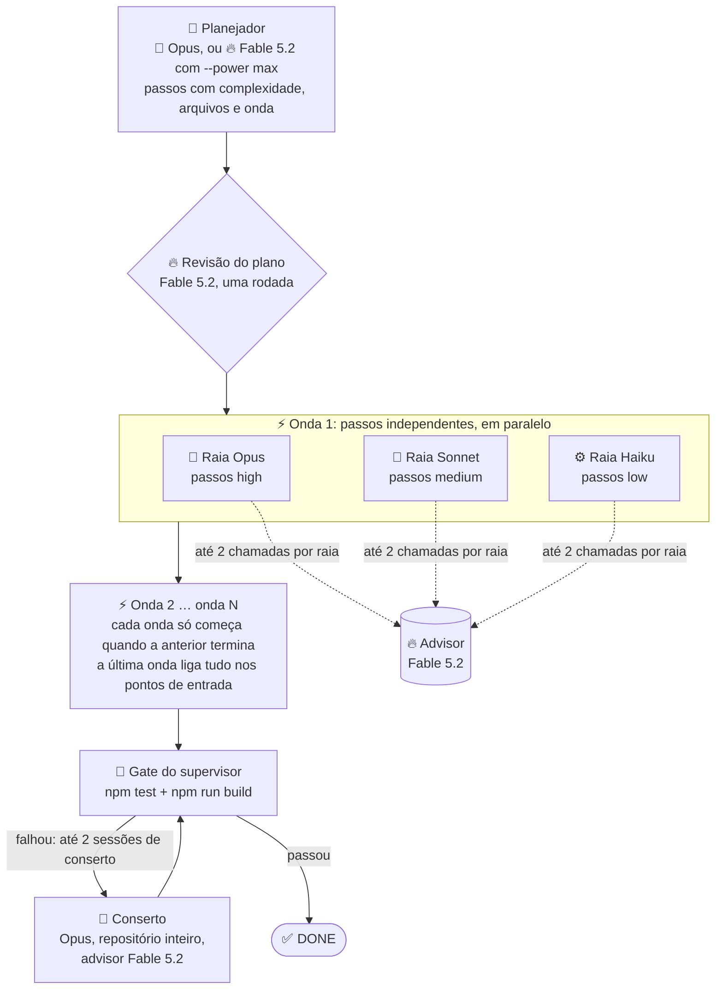

# Power Mode (graph-eng 1.4)

**Em uma frase:** cada papel sobe um degrau na família (o Fable 5.2 revisa e aconselha; com `max`, também planeja), os passos rodam em paralelo, e o gate continua decidindo o DONE.

O fluxo advisor da 1.3 já tinha a ideia certa: o modelo forte só revisa e aconselha, os mais baratos fazem o volume, e `npm test` + `npm run build` decidem o fim. O Power Mode leva isso ao limite em duas direções ao mesmo tempo:

1. **Inteligência onde ela paga.** Onde a 1.3 usava o Sonnet, o Power Mode usa o Opus; onde usava o Opus, usa o Fable 5.2. O plano é o que mais influencia a run inteira (o que cada sessão faz, em que ordem, em que arquivo), e o advisor é quem desbloqueia quando a sessão trava. São poucas chamadas, com o contexto inteiro, então é aqui que o modelo mais caro faz diferença. Com `--power max`, o Fable também escreve o plano.
2. **Velocidade onde ela é de graça.** O plano sai dividido em **ondas**. Dentro de uma onda, os passos são independentes e tocam arquivos diferentes, então rodam ao mesmo tempo, em **raias** separadas por modelo: o forte (Opus) pega os passos `high`, o médio (Sonnet) os `medium`, o barato (Haiku) os `low`. Três sessões em paralelo, cada uma com o repositório inteiro, nenhuma esperando a outra.

São duas configurações só, `--power` e `--power max`, de propósito: fácil de usar. Todas as chamadas usam o `--effort` da run, `medium` por padrão, que é o que a Anthropic recomenda para o Fable 5.2. Nada do que já funciona muda: isolamento do ambiente, shell só com os comandos do gate, gate externo do supervisor, sessões de conserto, evidência em `advisor-run.json`.

## Diagrama



## Quem faz o quê

| Papel | Padrão (1.3) | `--power` | `--power max` | Por quê |
| --- | --- | --- | --- | --- |
| Planejador | 📝 médio (Sonnet) | 🧠 **forte (Opus)** | 🔥 **Fable 5.2** | O plano define ondas, arquivos e complexidade; erro aqui vira retrabalho em todas as raias |
| Revisão do plano | 🧠 forte (Opus) | 🔥 **Fable 5.2** | 🔥 **Fable 5.2** | Segunda opinião do modelo mais forte, numa chamada só |
| Advisor | 🧠 forte (Opus) | 🔥 **Fable 5.2** | 🔥 **Fable 5.2** | Quem desbloqueia a sessão travada, vendo a transcrição inteira |
| Passos `high` | 📝 médio | 🧠 **forte (Opus)** | 🧠 **forte (Opus)** | Algoritmo, caso de borda, integração: o Opus é rápido o bastante e mais confiável que o Sonnet |
| Passos `medium` | 📝 médio | 📝 médio (Sonnet) | 📝 médio (Sonnet) | Lógica contida com contrato claro; Opus aqui seria desperdício |
| Passos `low` | ⚙️ barato | ⚙️ barato (Haiku) | ⚙️ barato (Haiku) | Tabela, constante, CSS, ligação simples |
| Conserto do gate | 📝 médio | 🧠 **forte (Opus)** + advisor Fable | 🧠 **forte (Opus)** + advisor Fable | O conserto vê o repositório inteiro e a saída do gate; é a hora de não economizar |

A diferença entre as duas é só quem escreve o plano. A divisão dos executores (Opus nos `high`, Sonnet nos `medium`, Haiku nos `low`) é a hipótese inicial; o benchmark testa outras combinações entre rodadas (Opus também nos `medium`; Sonnet também nos `high`) e cada run registra a raia por modelo, então a comparação sai do `advisor-run.json`.

## A lógica das ondas e raias

O planejador do Power Mode devolve, para cada passo:

```json
{ "step": "world.js: chunks, terreno, árvores, minério, edições e serialização", "complexity": "high", "files": ["src/engine/world.js"], "wave": 2 }
```

- **`wave`** diz quando o passo roda. Um passo só pode depender de passos de ondas anteriores. A onda 1 tem as fundações independentes; a última onda liga tudo nos pontos de entrada.
- **`files`** diz a pegada do passo. É o que torna o paralelismo seguro: duas sessões nunca editam o mesmo arquivo ao mesmo tempo.

O runner não confia cegamente no plano:

1. **Ondas com conflito de arquivo são divididas.** Se dois passos da mesma onda listam o mesmo arquivo (ou um passo não lista arquivo nenhum), o segundo vai para uma sub-onda seguinte. A ordem relativa dos passos nunca muda. Passo sem `wave` válida herda a onda do passo anterior.
2. **Dentro da onda, os passos viram raias por modelo.** Todos os `high` da onda numa sessão do Opus, todos os `medium` numa do Sonnet, todos os `low` numa do Haiku. No máximo três sessões ao mesmo tempo, cada uma com contexto contínuo entre os seus passos.
3. **As raias rodam em paralelo; as ondas, em série.** A onda seguinte só começa quando todas as raias da anterior terminaram, então ela já encontra o trabalho anterior na árvore de trabalho.
4. **Cada raia sabe que não está sozinha.** O prompt diz quais passos são dela, que outras sessões estão mexendo nos outros arquivos agora, que ela não deve criar nem editar arquivo fora da pegada dos seus passos, e que falha de teste em arquivo de outro passo não é dela.
5. **O gate roda uma vez, no fim de todas as ondas.** Se falhar, uma sessão de conserto inteira no Opus (repositório todo, advisor Fable), até 2 vezes, como hoje.

**Exemplo com o benchmark Minecraft** (10 passos do plano da 1.3):

| Onda | Raia Opus (`high`) | Raia Sonnet (`medium`) | Raia Haiku (`low`) |
| --- | --- | --- | --- |
| 1 | — | `noise.js` | `blocks.js`, `daynight.js` |
| 2 | `world.js`, `physics.js`, `mesher.js` | `raycast.js`, `inventory.js`, `crafting.js` | `mining.js` |
| 3 | render e mundo em chunks (`src/render/`) | HUD, menu, inventário (`src/ui/`) | — |
| 4 | `main.jsx`: ligar tudo | — | — |

Na run padrão da 1.3, as sessões do executor foram 80% dos 617 s, em série. Com três raias, a onda 2 roda no tempo da raia mais lenta, não na soma das três.

## Orçamento do advisor e esforço

- **Advisor:** 6 chamadas por run no Power Mode (contra 3 no padrão), com teto de 2 por sessão de raia. Cada raia recebe o saldo que sobrou no começo da onda; o que ela gastou é contado na transcrição da sessão, como hoje.
- **Esforço:** todas as chamadas, inclusive as do Fable, usam o `--effort` da run (`medium` por padrão, o que a Anthropic recomenda). Não há piso nem teto por papel.

## Flags

| Flag | Valores | O que faz |
| --- | --- | --- |
| `--power` | —, `max` | Liga o Power Mode; `--power max` (o `max` logo depois da flag) põe o Fable 5.2 também no plano. Só no host Claude. Não combina com `--executor`. `--power=max` é recusado. |
| `--haiku-max` | `low`, `medium`, `off` | Continua valendo: complexidade máxima que vai para o barato. Com `off`, os passos `low` vão para o Sonnet. |
| `--effort` | `low`, `medium`, `max` | Continua valendo para todas as chamadas. |

`plan --power` e `plan --power max` salvam o modo no plano; `implemente` sem tarefa reaplica. Como hoje, as flags de roteamento vão no `plan`. A flag `--fable-min` existiu nesta versão antes de ser publicada e saiu: é recusada como opção removida.

## Evidência

`advisor-run.json` ganha `power: true`, `powerMax`, e `routing` vira a lista de ondas:

```json
"routing": [
  { "wave": 1, "lanes": [{ "model": "sonnet", "steps": [2] }, { "model": "haiku", "steps": [1, 3] }] },
  { "wave": 2, "lanes": [{ "model": "opus", "steps": [4, 5, 6] }, { "model": "sonnet", "steps": [7, 8, 9] }, { "model": "haiku", "steps": [10] }] }
]
```

Cada sessão registra `wave`, `model`, `steps`, `status`, `summary`, `sessionId`, `advisorCalls` e `ms`. O custo continua dividido por modelo e por papel, então dá para ver exatamente quanto o Fable custou.

## O que o benchmark respondeu (Minecraft, 11/11/2026)

As 5 rodadas de cada variante estão em [docs/benchmarks/README.md](benchmarks/README.md), com a tabela completa, o custo por modelo e a análise de qualidade do código. Em resumo:

| Variante | Entregou | Custo (5 rodadas) | Tempo | Nota |
| --- | --- | --- | --- | --- |
| Padrão 1.3 | 5 de 5 | US$ 1,34 a 1,83 | 473 a 637 s | 55/55 sempre |
| `--power` (forte nos `high`) | 2 de 2 | US$ 7,70 a 9,62 | 1196 a 1617 s | 55/55 |
| `--power max` (forte nos `high`) | 0 de 2 | US$ 6,78 a 11,15 | 1020 a 1598 s | 55/55 no motor, sem jogo jogável |
| `--power` / `--power max` (forte nos `high` e `medium`) | 2 de 2 | US$ 10,79 a 12,95 | 1852 a 2079 s | 55/55 |
| `--power` (médio nos `high` e `medium`) | 2 de 2 | US$ 3,75 a 6,14 | 741 a 1175 s | 55/55, com conserto nas duas |
| `--power max` (médio nos `high` e `medium`) | 2 de 2 | US$ 2,75 a 3,15 | 618 a 740 s | 55/55, sem conserto |

As hipóteses da tabela abaixo não se confirmaram: o Power Mode nunca ficou abaixo do tempo do padrão, e o custo ficou entre 1,6 e 8 vezes o do padrão, não entre US$ 2 e 4. A nota e a cobertura da spec foram as mesmas; o código com o forte nos executores saiu maior e mais comentado, não melhor. **Recomendação:** o padrão continua o default. Quem quiser o Fable 5.2 no plano e na revisão deve usar `--power max` com o médio em todos os executores (`GRAPHENG_POWER_SPLIT=sonnet/sonnet`), a única configuração do Power Mode que entregou nas duas rodadas sem conserto e no tempo do padrão. A divisão padrão do Power Mode (forte nos `high`) fica como candidata a mudar na próxima versão, junto com os itens 34 e 35 de `melhorias-futuras.md` (raia que devolve `BLOCKED` sem rodar o gate; raia que devolve `DONE` com um arquivo da pegada no stub). O mesmo protocolo foi repetido numa tarefa maior, o souls-like (`test/fixtures/benchmark-soulslike/`, 66 testes ocultos, TypeScript estrito), uma run de cada: padrão 66/66 por US$ 1,57 em 501 s; `--power` 62/66 por US$ 7,12 em 1241 s (duas raias perdidas por um `cd` no Bash e conserto no forte); `--power max` 61/66 por US$ 3,56 em 702 s sem conserto. Quatro desses ocultos cobravam valores que o contrato não fixava (corrigido depois); fora deles, cada run do Power Mode ficou com uma falha real de regra que a padrão não teve. Na segunda rodada, com o contrato fixado e a ambientação pedida (árvores, pedras, cavaleiro com armadura, minotauro): padrão 65/66 por US$ 2,04 em 641 s; `--power` 66/66 por US$ 3,37 em 856 s; `--power max` 66/66 por US$ 4,12 em 913 s, as oito raias `DONE` sem conserto, 30 a 36 % mais código de cenário. Detalhes em [docs/benchmarks/README.md](benchmarks/README.md).

## O que o benchmark precisava responder (plano original)

Três variantes, no mesmo esqueleto do Minecraft (`test/fixtures/benchmark-minecraft/bench.sh`), **5 rodadas de cada**, alternando as três a cada rodada (rodada 1 das três, depois rodada 2 das três) para a comparação ficar pareada mesmo que o uso acabe no meio:

| Variante | Comando | Hipótese |
| --- | --- | --- |
| Padrão 1.3 (referência) | sem flag; já medido uma vez: 55/55, US$ 1,59, 617 s | as 5 rodadas mostram a variância da referência |
| Power | `--power` | 55/55, tempo bem abaixo de 617 s, custo entre US$ 2 e 4 (Opus no plano, Fable na revisão e no advisor) |
| Power max | `--power max` | 55/55; só vale o custo extra se o plano do Fable reduzir conserto, chamadas ao advisor ou tempo |

Entre uma rodada e a seguinte, o que falhou ou saiu caro vira ajuste no graph-eng (prompt, roteamento, divisão dos executores), commitado antes da rodada seguinte: a sequência mede a melhoria, não só a variância. Depois do Minecraft, um jogo mais complexo repete o mesmo protocolo.

O que medir em cada run: testes ocultos (55), build, smoke visual, custo total e por modelo, tempo total e por onda, chamadas ao advisor, sessões de conserto. A variante que mantém 55/55 com o menor tempo vira a recomendação do Power Mode; o Fable no plano só fica no `max` se mudar a nota ou o tempo.

## Riscos e o que segura cada um

| Risco | O que segura |
| --- | --- |
| Duas raias editam o mesmo arquivo | Pegada por passo validada antes de rodar; conflito divide a onda |
| Raia depende de passo da mesma onda | O prompt do planejador proíbe; o conserto no Opus pega o que escapar |
| `npm test` de uma raia falha por arquivo de outra | O prompt diz para ignorar falha fora da pegada; o gate oficial é o do supervisor, no fim |
| Fable indisponível ou limite de uso | A chamada falha com `USAGE_LIMIT` ou `MODEL_UNAVAILABLE` e a run bloqueia com o motivo legível; nada de fallback silencioso para outro modelo |
| Três sessões ao mesmo tempo num Mac de 16 GB | Teto de três raias (uma por modelo); os comandos do gate nas raias são leves (`node --test`, `vite build`) |
